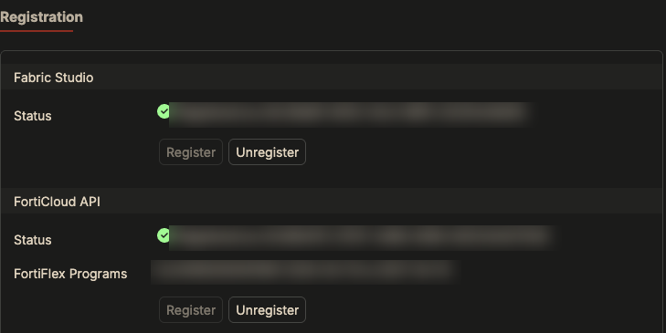
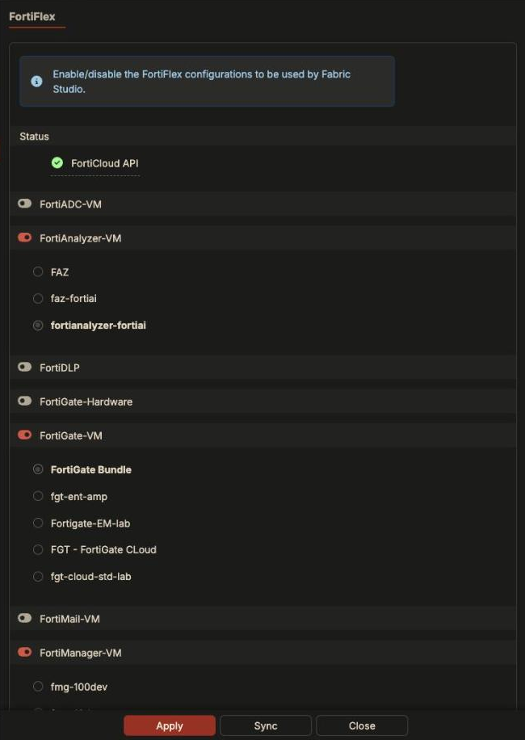
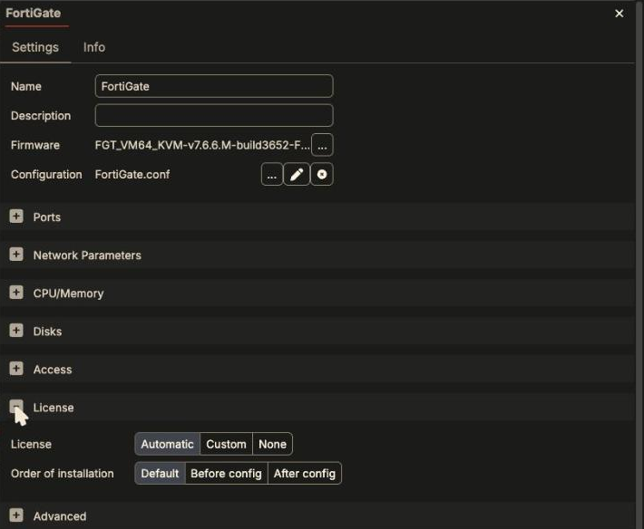

Fabric Studio licenses devices for you when it installs them. It needs a
source of licenses: **FortiFlex** (preferred, no files to manage) or **.lic
files** you upload. Each device then takes one according to its **License**
setting.

*Screenshots are from Fabric Studio 2.2.35.*

## Option 1 (preferred): FortiFlex

With FortiFlex, Fabric Studio creates, refreshes and stops license tokens
through the FortiFlex API. You never handle a license file.

### 1. Get a FortiFlex program

Fortinet employees: ITF the post-paid FortiFlex SKU
**FC-10-ELAVS-221-02-DD** and activate it on the
[Support portal](https://support.fortinet.com/).

### 2. Create an API user

On the Support portal (IAM), create an API user whose permission profile has:

- **Asset Management**: *Read & Write*, at least for *Asset Maintenance* and
  *Entitlement Management*.
- **FortiFlex**: access enabled, *Read/Write*.

{}
**One API user per Fabric Studio.** A FortiFlex API user can't be shared
between Fabric Studio instances. Every API user of an account sees every
license of the others, so put each Fabric Studio in its own **Sub-OU** with
exactly one API user. When you use a Sub-OU user, you also need that Sub-OU's
**account ID** (it isn't in the API credential file).
{}

### 3. Register the API user in Fabric Studio

**System > Registration**, section **FortiCloud API**, click **Register**
and enter the API ID, password and (for a Sub-OU) the account ID.

When it works, the status turns green and **FortiFlex Programs** lists your
program and its dates:



The same from the Fabric Studio CLI:

```bash
system forticloud account set <API ID> --accountId <Account_ID>   # prompts for the password
```

### 4. Choose which FortiFlex configuration each product uses

**System > FortiFlex** lists every product type. Toggle on the products you
want licensed by FortiFlex, and pick which FortiFlex **configuration** each one
uses (the configurations are created on the FortiFlex portal). Click
**Apply**.



If a configuration you just created on the portal is missing, click **Sync**,
or from the CLI:

```bash
system license flex program refresh
system license flex config refresh
```

### 5. Install a device

That's all. Leave the device's **License** on **Automatic** (the default) and
install it. When the pool is empty, Fabric Studio creates a new token on its
own. You'll see the license step in the install log, and on a FortiGate
`get system status` shows `License Status: Valid` a few minutes after the
install.

### FortiFlex things to know

- **Uninstalling stops the license.** Fabric Studio stops FortiFlex tokens
  when a fabric is uninstalled, to save points. It isn't guaranteed: check
  your point consumption on the portal.
- **A reactivated license can look expired for up to 30 minutes.** FortiGuard
  takes that long to sync with FortiFlex. Before a workshop, reactivate ahead
  of time:

  ```bash
  system license flex settings set '{"stop_on_release": false}'
  system license flex license reactivate all
  ```

  and when it's over:

  ```bash
  system license flex license stop all
  system license flex settings set '{"stop_on_release": true}'
  ```

- **API quotas.** Fabric Studio holds itself to 100 FortiFlex calls a minute
  and 1000 an hour. A big fabric installing many devices at once can hit
  them.

## Option 2: upload .lic files

For products or SKUs you don't have in FortiFlex, upload license files under
**Repositories > Home > Licenses**, or from the CLI:

```bash
scp FGVM00000000.lic admin@<fabric-studio>:
ssh admin@<fabric-studio> system license import FGVM00000000.lic
```

The serial number is read from the file name, and Fabric Studio derives the
VM's UUID from it, so the device boots with the UUID the license expects.

If both are available, Fabric Studio uses FortiFlex first.

{}
**FortiManager and FortiSandbox `.lic` files are bound to a management IP.**
Fabric Studio assumes `10.0.0.1` unless the license says otherwise. If the
device's management address differs, it reports `ip doesn't match`. Set the
license's address and reinstall the device:

```bash
system license update <ID> '{"mgmt_addr": "<license IP>"}'
```

Step by step: [License "ip doesn't match"]({}).
{}

## The device's License setting

Open a device, **Edit > License**:



| Setting | Choices | Meaning |
|---|---|---|
| **License** | **Automatic** (default) | Fabric Studio picks a license. If the device supports one and none is available, the install fails with `No license for fgt000 (LIC,FLEX)`. |
| | **Custom** | You pick one specific license (already uploaded, or already created in FortiFlex). |
| | **None** | No license is installed. |
| **Order of installation** | **Default** | Use the firmware's own order. For FortiGate that's the license first, then the saved configuration. |
| | **Before config** / **After config** | Force the license before or after the configuration is restored. Use **After config** when the device's saved configuration supplies something the license needs, such as DNS or its route out. |

What the order changes, from two installs of the same FortiGate with a saved
configuration:

| Default (license first) | After config |
|---|---|
| Temporary route and DNS over the management network (`10.254.254.254`) | Same temporary route |
| `execute vm-license`, reboot, wait for `License Status: Valid` | **TFTPRestore** of the saved config, reboot |
| **TFTPRestore** of the saved config, reboot | `Internet access validated`, then `execute vm-license` over the restored config's own route, reboot, `Valid` |

Both ended licensed. With **After config** the license request goes out the
way the saved configuration routes it, not over the management network.

Licenses are **never exported** with a fabric (a **Custom** assignment exports
only the serial number). Whoever imports your fabric licenses it from their
own FortiFlex or .lic files.

## When licensing fails

| Symptom | Likely cause |
|---|---|
| Install fails: `No license for <device> (LIC,FLEX)` | No FortiFlex pool enabled for that product (System > FortiFlex) and no matching `.lic`. |
| `License Status: Warning`, or Valid then drifting | The device has no route or DNS to FortiGuard. See [No Internet from a Device]({}). |
| Freshly reactivated FortiFlex license shows expired | FortiGuard sync lag, up to 30 minutes. Wait, or reactivate ahead of time. |
| FortiFlex configuration missing from System > FortiFlex | Program/config not refreshed: **Sync**, or `system license flex config refresh`. Sub-OU user without account ID. |
| FortiManager `ip doesn't match` | License `mgmt_addr` (see above). |

More detail in the Fabric Studio documentation:
[FortiFlex licenses](https://register.fabricstudio.net/docs/fabric-studio/2.2.35/licenses/flexvm.html)
and [Configuring a device's license](https://register.fabricstudio.net/docs/fabric-studio/2.2.35/licenses/general.html)
(sign-in required; also under `/help/licenses/` on your own Fabric Studio).
