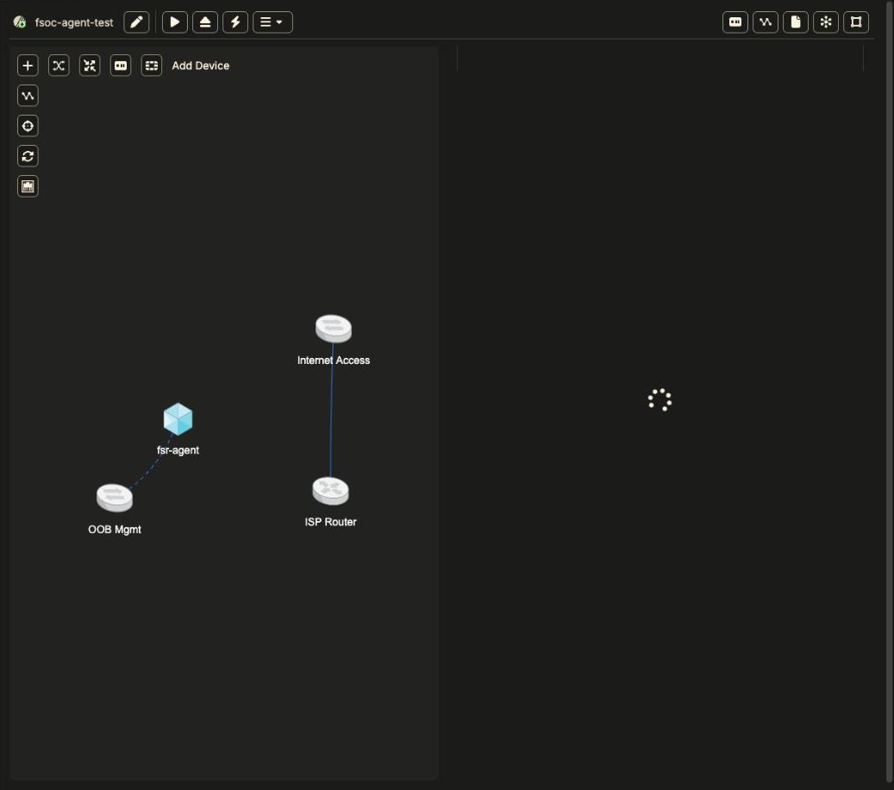
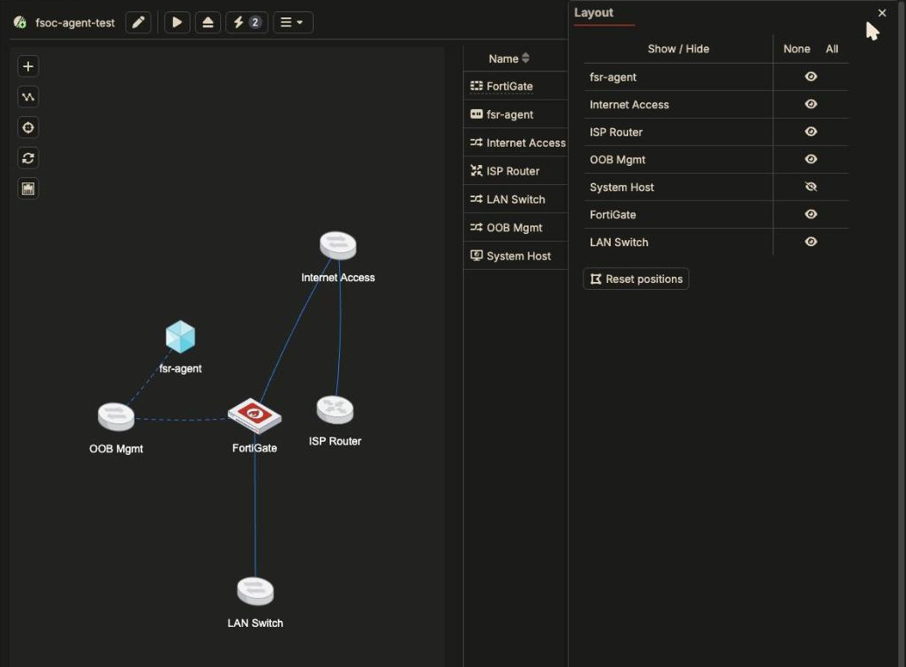
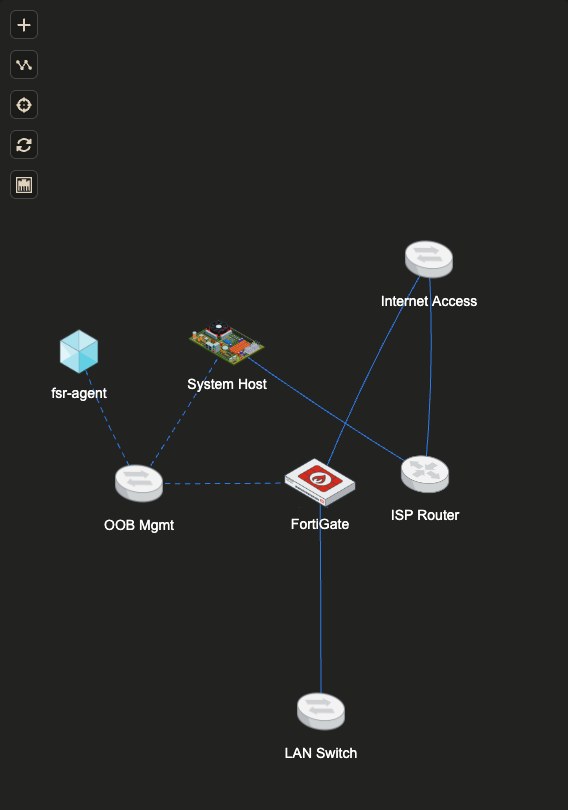
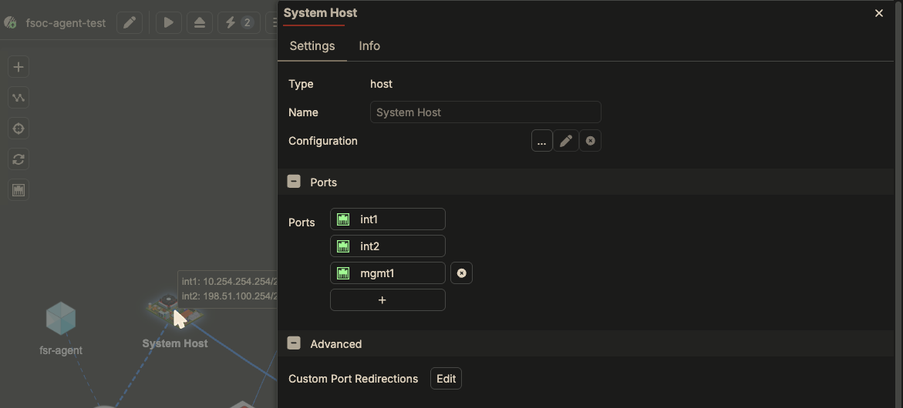
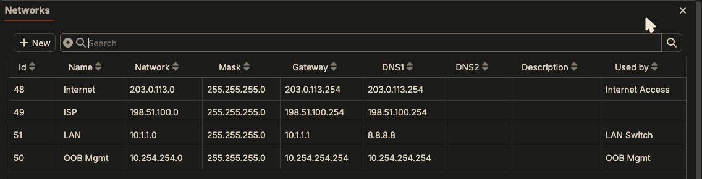

Every fabric created with **Create > Fabric** starts from the `default` base
template. Before you add anything, it already contains four native devices and
three networks. Knowing what each one does saves most of the networking
confusion later.



The System Host is part of every fabric but hidden from the diagram. See
[Show the System Host](#show-the-system-host-the-layout-button).

*Screenshots on this chapter are from Fabric Studio 2.2.35. This fabric also has
one extra LXC (`fsr-agent`); a brand-new fabric has only the four native
devices.*

## The native devices

| Device | Type | What it does |
|---|---|---|
| **OOB Mgmt** | Switch (management) | The out-of-band management switch. Every device you add is cabled to it automatically on **port1**. Fabric Studio uses this path to configure, license, back up, and give you SSH/HTTPS access to devices. |
| **Internet Access** | Switch | The first data switch. Cable a device's data port here to give it an address on the **Internet** network. |
| **ISP Router** | Router | A Fabric Studio router. Its **port1** (`203.0.113.254`) sits on Internet Access and is the gateway for that network. Its **port2** (`198.51.100.253`) sits on the ISP network and NATs traffic towards the System Host. |
| **System Host** | Host | **The Fabric Studio appliance itself, and the only way out of the fabric.** Its **mgmt1** port is the Fabric Studio's own NIC. All fabric traffic to your network or the internet leaves through it. Inside the fabric it has **int1** (`10.254.254.254`, gateway/DNS for OOB Mgmt) and **int2** (`198.51.100.254`, upstream of the ISP Router). SSH/HTTPS port forwards to devices also land on it. |

Whatever path a device takes, **internet traffic always leaves through the
System Host's mgmt1, the Fabric Studio's NIC**:

```text
device port2 ─> Internet Access ─> ISP Router (NAT) ─> System Host ─> mgmt1 ─> your network / internet
 203.0.113.x      switch            .254 ─ .253         int2 .254     (Fabric Studio NIC)
```

If the Fabric Studio VM itself can't reach the internet (no route, a proxy, or
a firewall in front of it), no device in any fabric can either.

## Show the System Host: the Layout button

**The System Host is hidden in the topology by default**, so its cables to the
ISP Router and OOB Mgmt aren't drawn either. That makes the path out of the
fabric invisible. To show it:

1. Click the **Layout** button, the rightmost icon at the top right of the fabric view.
2. Click the crossed-out eye next to **System Host**.



The topology now shows the full path out:



Hover over the System Host to see its addresses, or open it to see its three
ports:



The Layout panel can also hide busy devices, and **Reset positions** re-lays
out the diagram.

{}
Older pages and slides call this router "NAT Internet". The default template
in current Fabric Studio builds names it **ISP Router**.
{}

## The networks

A *network* in Fabric Studio is just addressing: a subnet, a gateway and DNS
servers. A *switch* is the L2 segment that devices plug into. A switch has an
**auto-address network**: when you cable a device port to the switch, the port
gets the next free address from that network.

| Network | Subnet | Gateway / DNS | Auto-addresses ports on |
|---|---|---|---|
| **Internet** | `203.0.113.0/24` | `203.0.113.254` | Internet Access |
| **ISP** | `198.51.100.0/24` | `198.51.100.254` | - (link between ISP Router and System Host) |
| **OOB Mgmt** | `10.254.254.0/24` | `10.254.254.254` | OOB Mgmt |

All of a fabric's networks, and which switch uses each one, are listed under
the **Networks** button (top right of the fabric view, second from the right):



{}
`203.0.113.0/24` and `198.51.100.0/24` are documentation ranges (RFC 5737),
and `10.254.254.0/24` is a private range (RFC 1918). None of them are real
public addresses; they exist only inside the fabric, and the ISP Router NATs
them on the way out.
{}

## Cable styles in the topology view

- **Dashed line**: a management cable (to OOB Mgmt).
- **Solid line**: a data cable.

## Next

Build on this in [Your First Fabric]({}).
