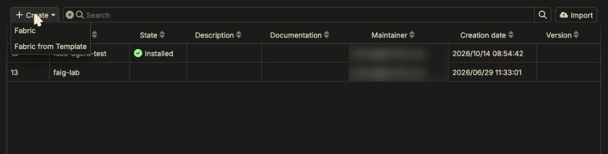
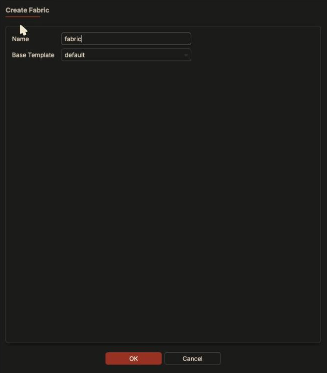
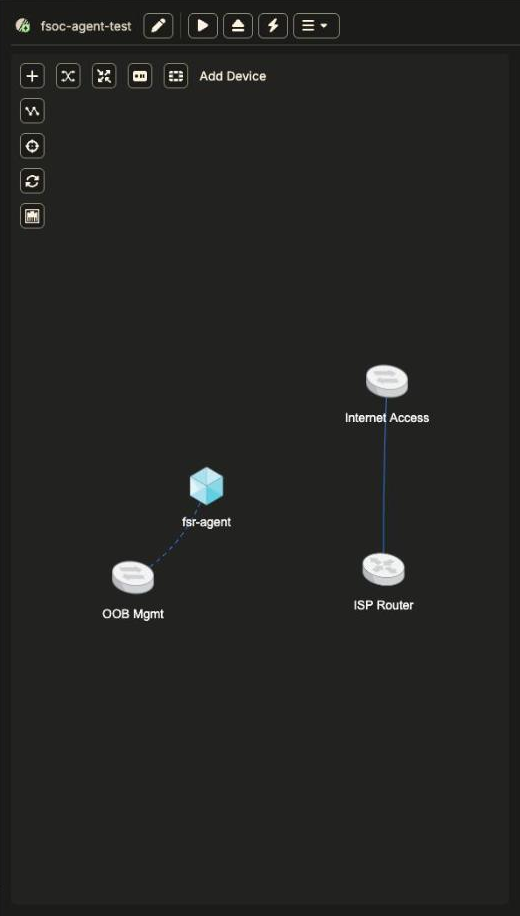
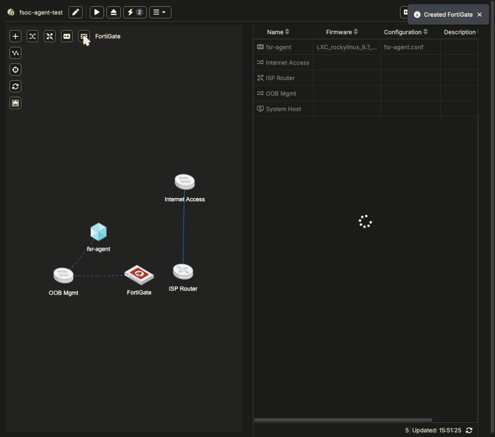
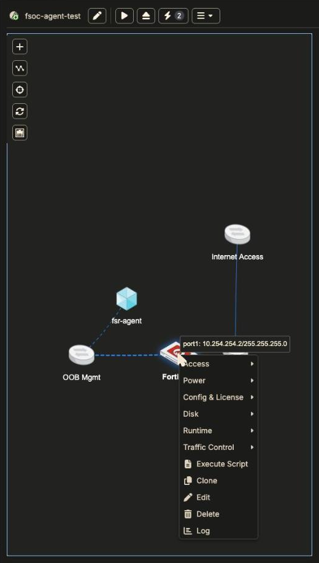
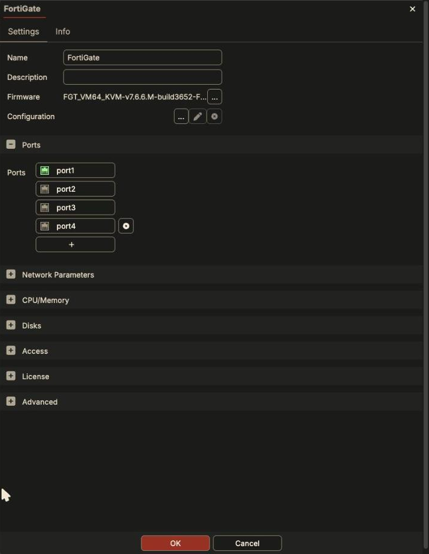
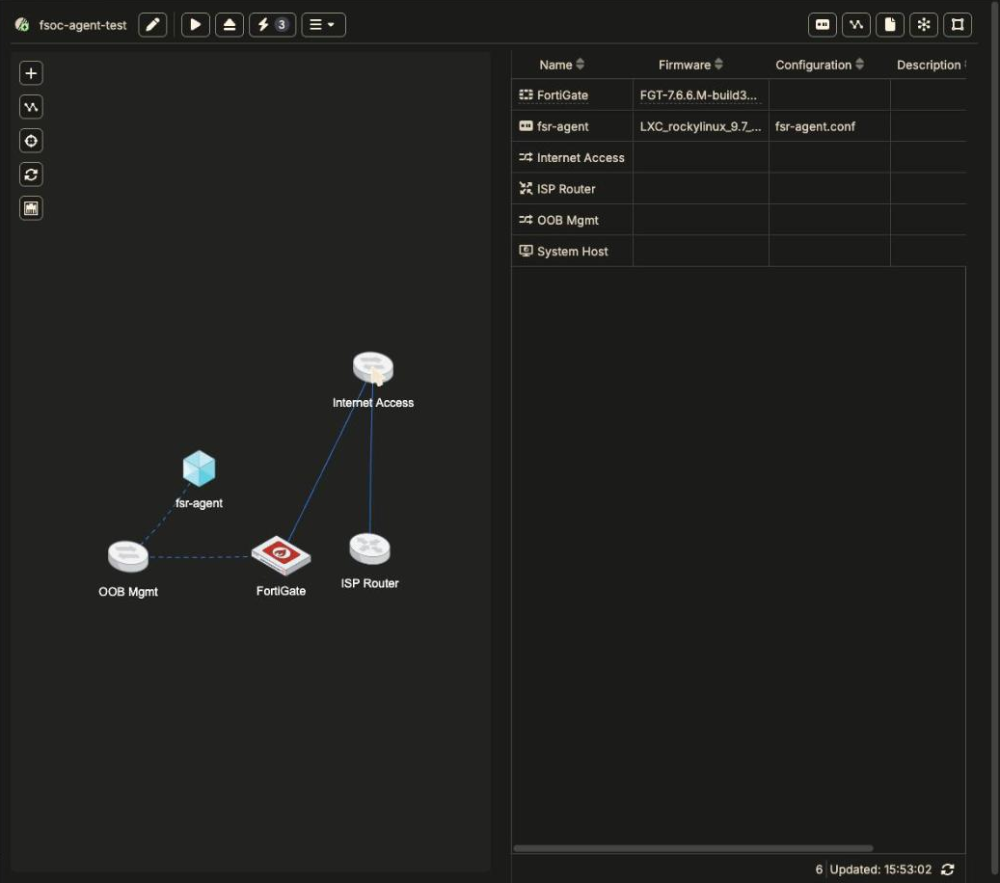
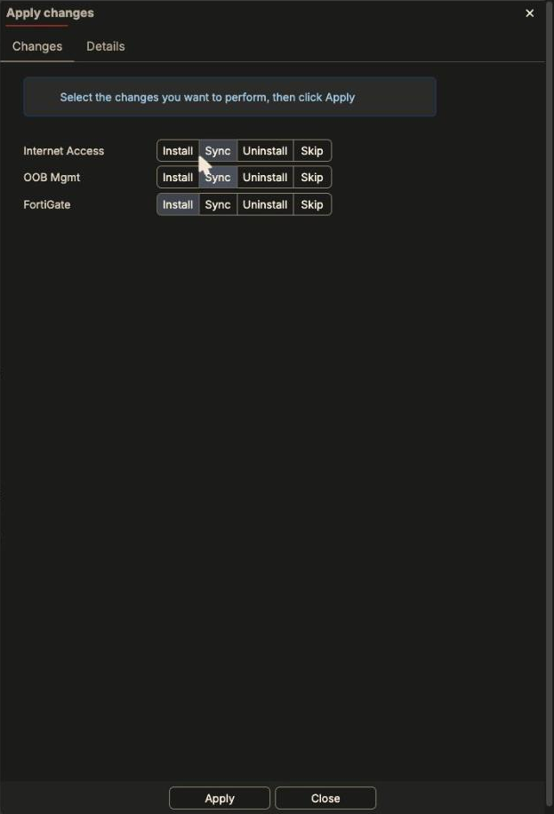
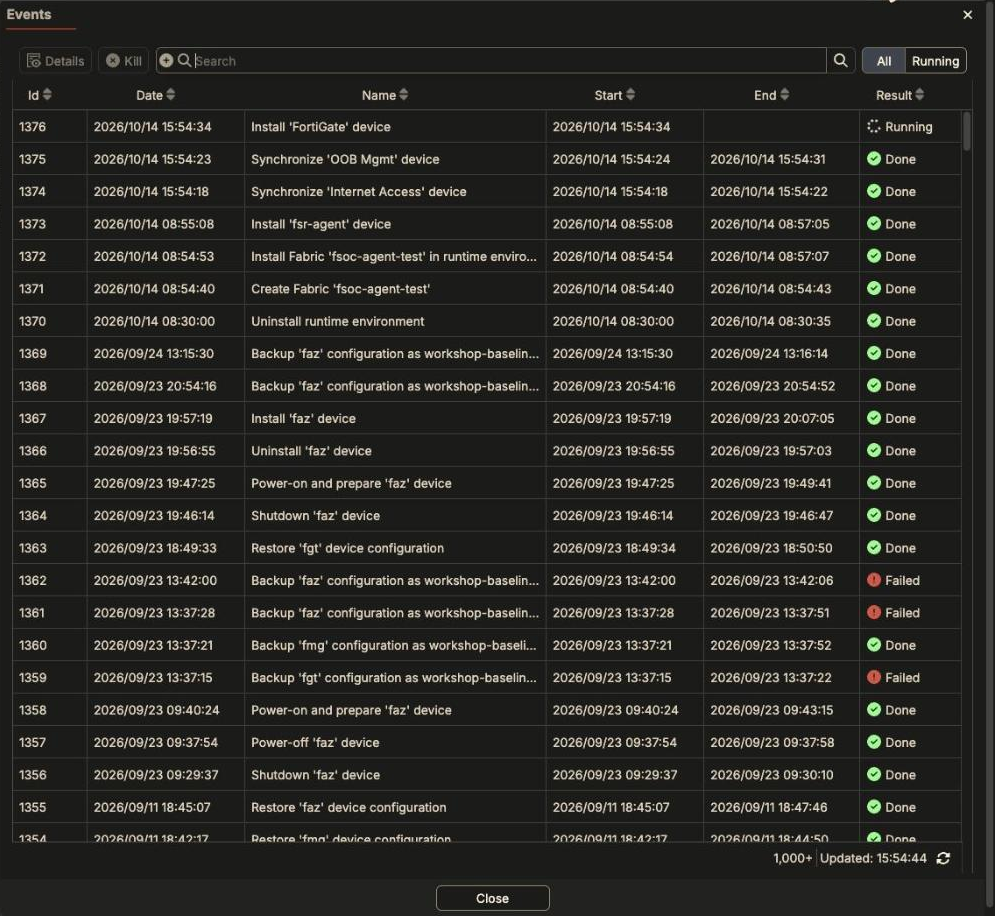

By the end of this page you'll have a licensed FortiGate with internet access,
and you'll know how to check that it really has internet access.

**Before you start:** your Fabric Studio is registered
([Deploy Fabric Studio]({}))
and nothing else important is running on it. Installing a fabric stops
whichever fabric is currently running.

## 1. Create the fabric

1. Go to **Fabric Workspace**.
2. Click **Create > Fabric**.

   

3. Enter a name. Leave **Base Template** on `default`. Click **OK**.

   

The fabric opens in the topology view with the default devices: OOB Mgmt,
Internet Access, ISP Router, and the System Host. See
[What's in a New Fabric]({}) for what each one does.

## 2. Add a FortiGate

Hover over **+** at the top left of the topology. Four buttons appear:
**Switch**, **Router**, **Device** (any supported product), and **FortiGate**
(a shortcut).



Click **FortiGate**. It appears already cabled to **OOB Mgmt** on port1
(`10.254.254.2`), and the **⚡ Apply changes** badge counts the pending change.



Nothing has been deployed yet. You've only changed the fabric's model.

Right-click the device for everything you can do to it. **Edit** opens its
settings:





The **Firmware** field shows which image will be used (here FortiGate 7.6.6).
Change it with **…** if you need another version.

## 3. Cable the WAN port

1. Click **Add Cable** (the second button on the left).
2. Drag from the FortiGate to **Internet Access**.



Two things happen automatically, and both are worth checking (device
**Edit**):

- **port2** gets an address from the Internet network: `203.0.113.1/24`.
- **Network Parameters** switches to **Predefined > Internet**, so the default
  route and DNS will be `203.0.113.254`.

Management cables are drawn dashed and data cables solid.

{}
Cable the WAN (internet-facing) port **first**. The first data cable decides
the device's default route. See
[Addressing and Routing]({}).
{}

## 4. Deploy with Apply changes

Click **⚡ Apply changes**. Every row defaults to **Install**. Set the two
switches to **Sync** and leave the FortiGate on **Install**:



Click **Apply**. Why not the ▶ Install button? On a fabric that's already
running, it reinstalls *every* device. See
[Install vs Apply vs Sync]({}).

## 5. Watch it install

Open the task list (list icon, top right):



A FortiGate install takes about 3 minutes. In the task log you'll see it boot,
connect its cables, check internet access, activate the FortiFlex license,
reboot, wait for `License Status: Valid`, then apply port2's address, the
default route, and DNS.

## 6. Prove it works

Open the FortiGate's CLI: select it in the device table and click **SSH**, or
right-click **Access > SSH**. Then:

```text
get system status | grep License
execute ping 8.8.8.8
execute ping update.fortiguard.net
get router info routing-table all
```

Expected:

```text
License Status: Valid
5 packets transmitted, 5 packets received, 0% packet loss
PING fds1.fortinet.com (...): 56 data bytes ... 0% packet loss
S*      0.0.0.0/0 [10/0] via 203.0.113.254, port2, [1/0]
```

The hostname ping is the important one: it proves DNS works, and DNS is what
FortiGuard and licensing depend on. If any of these fail, go to
[No Internet / License Warning]({}).

## Next

- Put a client behind the FortiGate:
  [A LAN behind a FortiGate]({}).
- Back up the configured device (right-click **Config & License > Backup
  Config**) so a reinstall restores it.
- Start from a pre-built lab instead:
  [Fabrics from Templates]({}).
