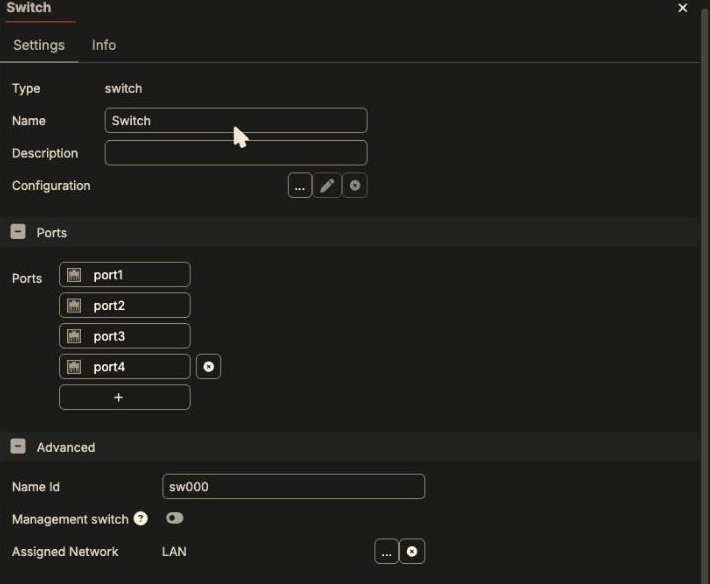
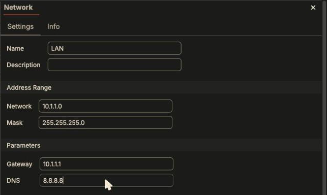
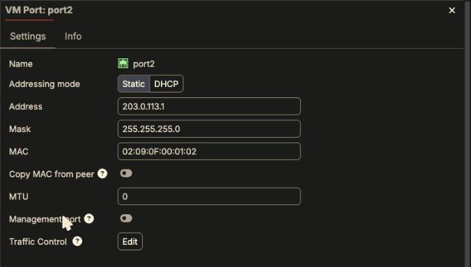
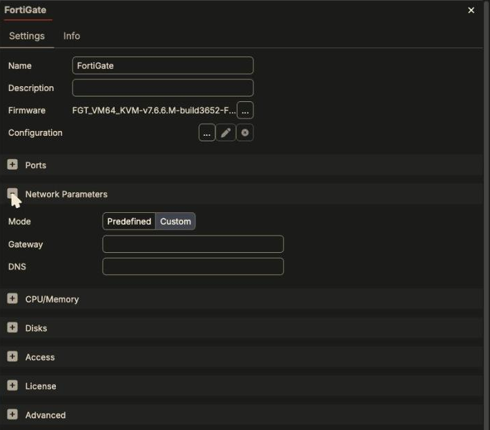
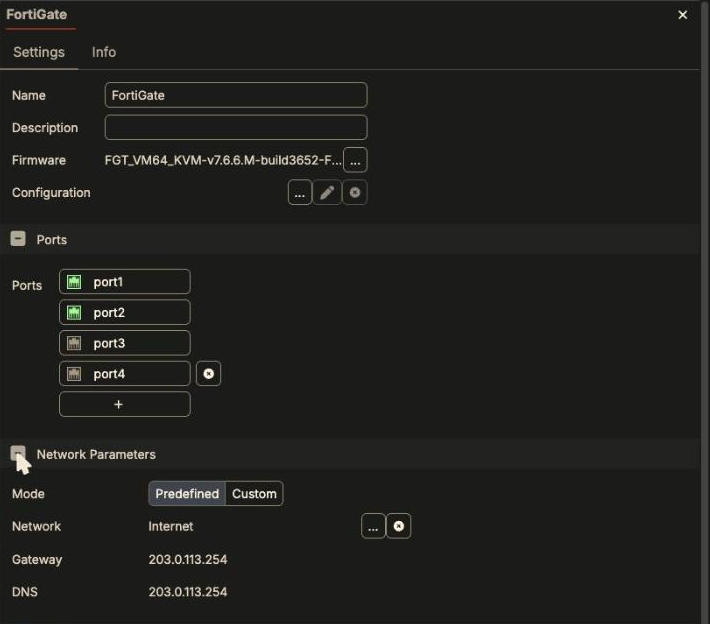
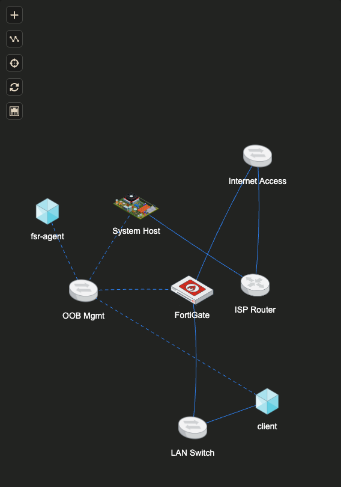
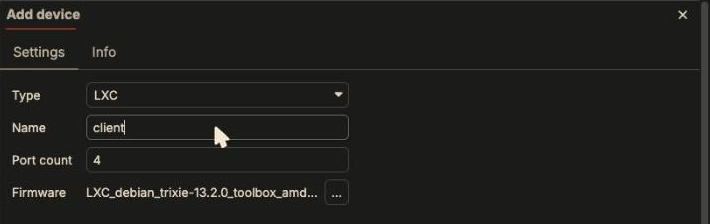
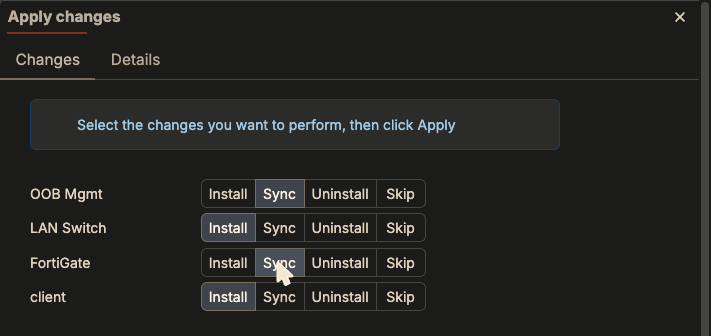
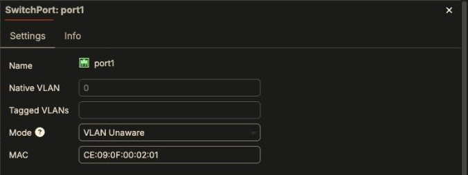

Most "my device has no internet" problems come down to three settings. This
page explains each one and shows where it lives in the UI.

## 1. A port's address comes from the switch it's cabled to

Each switch has an **Assigned Network** (switch **Edit > Advanced**). When you
cable a device port to the switch, Fabric Studio gives that port the next free
address in that network.

| Switch | Assigned network | A port cabled here gets |
|---|---|---|
| OOB Mgmt | OOB Mgmt `10.254.254.0/24` | `10.254.254.x` (always port1) |
| Internet Access | Internet `203.0.113.0/24` | `203.0.113.x` |
| **A switch you add** | **none** | **no address** |



{}
**A switch you add has no Assigned Network.** Ports cabled to it get no
address. Create a network (subnet, gateway, DNS) and assign it before you
cable devices to the switch. You can create one right from the picker:
**Assigned Network > … > + New**.
{}



To check or override one port's address, open the device, **Ports**, click the
port:



## 2. A device's default route and DNS come from ONE network

A device has a single **Network Parameters** setting, and that's where its
default gateway and DNS server come from. It has two modes:

- **Predefined**: pick one of the fabric's networks, and use its gateway and DNS.
- **Custom**: type a gateway and DNS.

A freshly added device has **nothing** set:



**The first data cable you add sets it.** After cabling the FortiGate's port2
to Internet Access, Network Parameters switched to **Predefined > Internet**
(gateway and DNS `203.0.113.254`) on its own:



That's what you want for the WAN cable. It isn't what you want if your first
data cable goes to an isolated LAN or a license segment. The device's default
route then points at a network with no way out. **Cable the WAN port first, or
check Network Parameters after cabling.**

### What Fabric Studio actually configures (FortiGate)

The install log shows two phases:

1. **License phase.** Default route and DNS point at the System Host on the
   management network (`10.254.254.254` via port1). Fabric Studio pings
   `fortinet.com`, activates the license, reboots, and waits for
   `License Status: Valid`.
2. **Final phase.** It **replaces** that route and DNS with the Network
   Parameters values, e.g. `gateway 203.0.113.254` via port2. If the device
   has a saved configuration, this phase is a config restore instead, and the
   route and DNS come from that file.

So a device can license successfully and *then* lose internet, if Network
Parameters names a network whose gateway doesn't route out. The symptom shows
up later as a FortiGuard/FortiCare problem, not a network error. See
[No Internet from a Device]({}).

{}
Gateway and DNS are written into the guest **when it is installed**.
Changing Network Parameters, or a network's gateway/DNS, on a running device
needs a reinstall of that device to take effect. On a **FortiGate with a saved
configuration** they aren't applied at all: the config file wins, so make the
change inside FortiOS and back up again. An **LXC** device always takes them
from Network Parameters, because its backup holds no network settings (see
[Saving State]({})).
{}

## 3. Getting out: the default path to the internet

Everything leaves the fabric through the **System Host**, which is the Fabric
Studio appliance itself, via its **mgmt1** NIC. The System Host is hidden in
the diagram by default. Use the Layout button to show it
([how]({})).

```text
device port2 ─> Internet Access ─> ISP Router (NAT) ─> System Host ─> mgmt1 ─> internet
 203.0.113.x      switch            .254 ─ .253         int2 .254     (Fabric Studio NIC)
```

Verified on a FortiGate cabled to Internet Access with default settings:

```text
# get router info routing-table all
S*      0.0.0.0/0 [10/0] via 203.0.113.254, port2, [1/0]
C       10.254.254.0/24 is directly connected, port1
C       203.0.113.0/24 is directly connected, port2

# execute ping 8.8.8.8
5 packets transmitted, 5 packets received, 0% packet loss
# execute ping update.fortiguard.net
PING fds1.fortinet.com (173.243.138.71): 56 data bytes
5 packets transmitted, 5 packets received, 0% packet loss
```

Test DNS as well as IP. `ping 8.8.8.8` working while `ping update.fortiguard.net`
says `bad address` means routing is fine and DNS is not.

## 4. A LAN behind a FortiGate

This builds on [Your First Fabric]({}): a
licensed FortiGate with port2 on Internet Access. The goal is a client on a LAN
that reaches the internet through the FortiGate.



### Step 1: a switch with its own network

1. **+ > Switch**. Open it, rename it (**LAN Switch**), and under **Advanced >
   Assigned Network** click **…**, then **+ New**.
2. Create the network:

   | Field | Value | Why |
   |---|---|---|
   | Network / Mask | `10.1.1.0` / `255.255.255.0` | The LAN subnet. |
   | **Gateway** | `10.1.1.1` | **The FortiGate's LAN address.** Clients use this as their default route. |
   | DNS | `8.8.8.8` | A resolver clients can reach through the FortiGate. |

   

3. Select it as the switch's Assigned Network and click **OK**.

   

{}
Addresses are handed out from `.1` upwards, in cabling order. **Cable the
FortiGate to the switch before any client**, so it gets `.1`, the address you
gave as the gateway. If a client gets `.1` instead, every client's default route
points at that client. If you'd rather use another gateway address, set it on
the FortiGate's port by hand (device **Edit > Ports**).
{}

### Step 2: cable the FortiGate to the LAN

Add a cable from the FortiGate to LAN Switch. Its next free port (port3) gets
`10.1.1.1`. The FortiGate's **Network Parameters stay on Internet**: only the
*first* data cable sets them, so its default route still goes out port2.

### Step 3: add the client

1. **+ > Device**, choose a type (an **LXC** is the quickest client to deploy),
   name it, and click **OK**.

   

2. It lands cabled to OOB Mgmt on its first port. Cable it to **LAN Switch**.
   Its second port gets `10.1.1.2`, and because that's its first *data* cable,
   its **Network Parameters** become **Predefined > LAN**.

### Step 4: Apply changes, and don't reinstall the FortiGate

Apply changes lists every touched item, **all defaulting to Install, including
the running FortiGate**:



| Row | Choose |
|---|---|
| LAN Switch, client | **Install** (they're new) |
| OOB Mgmt | **Sync** |
| FortiGate | **Sync** (Install would redeploy it and re-license it from scratch) |

### Step 5: configure FortiOS. Fabric Studio won't

**Sync wires port3 into the LAN switch but does not configure the address
inside FortiOS.** After Sync, `show system interface port3` has no IP. Fabric
Studio only writes interface addresses during a device *install*, and only when
the device has no saved configuration. It never writes firewall policy. See
[What Fabric Studio configures by itself]({}). On the FortiGate:

```text
config system interface
    edit port3
        set mode static
        set ip 10.1.1.1 255.255.255.0
        set allowaccess ping
        set role lan
    next
end
config firewall policy
    edit 0
        set name "LAN-to-Internet"
        set srcintf "port3"
        set dstintf "port2"
        set srcaddr "all"
        set dstaddr "all"
        set action accept
        set schedule "always"
        set service "ALL"
        set nat enable
    next
end
```

Without the policy the client can ping `10.1.1.1` and nothing beyond it.

### Step 6: verify from the client

```text
# ip route
default via 10.1.1.1 dev eth1 onlink
10.1.1.0/24 dev eth1 proto kernel scope link src 10.1.1.2
10.254.254.0/24 dev eth0 proto kernel scope link src 10.254.254.3

# traceroute -n 8.8.8.8
 1  10.1.1.1          FortiGate port3
 2  203.0.113.254     ISP Router
 3  198.51.100.254    System Host  ->  out its mgmt1 (the Fabric Studio NIC)
```

## 5. A device on two switches: which default route wins?

The client above is cabled to **two** switches: OOB Mgmt (eth0, `10.254.254.3`)
and LAN Switch (eth1, `10.1.1.2`). Both networks have a gateway. It still gets
exactly **one** default route, from the network named in its **Network
Parameters**:

| | Network | Gateway | What the client gets |
|---|---|---|---|
| eth0 | OOB Mgmt | `10.254.254.254` | connected route only (`10.254.254.0/24 dev eth0`) |
| eth1 | LAN | `10.1.1.1` | **`default via 10.1.1.1 dev eth1`**, plus DNS `8.8.8.8` |

The management network isn't used for the default route when Network Parameters
names a data network. Fabric Studio uses it to reach the device, not the other
way round. The one exception
is a FortiGate's **licensing** step during install, which temporarily routes
via the System Host on OOB Mgmt and then switches to the Network Parameters
network (see [What Fabric Studio actually configures](#what-fabric-studio-actually-configures-fortigate)).

The same rule holds with more data ports. We cabled the client to a third
switch, **LAN2** (`10.2.2.0/24`, gateway `10.2.2.254`, DNS `9.9.9.9`), and
reinstalled it:

```text
# ip route
default via 10.1.1.1 dev eth1 onlink
10.1.1.0/24 dev eth1 proto kernel scope link src 10.1.1.2
10.2.2.0/24 dev eth2 proto kernel scope link src 10.2.2.1
10.254.254.0/24 dev eth0 proto kernel scope link src 10.254.254.3
# cat /etc/resolv.conf
nameserver 8.8.8.8
```

LAN2 gave eth2 an address and a connected route, nothing more. Network
Parameters stayed on **LAN**: it's set by the **first data cable** unless you
change it. If a client defaults to the wrong network, open it, set
**Network Parameters > Predefined** to the right one, and reinstall the client.

## VLANs

Switches are Open vSwitch bridges. VLAN tagging is set on the **switch port**,
not on the device: open the switch, click the port under **Ports**, and the
**SwitchPort** dialog has the VLAN fields:



| Field | Meaning |
|---|---|
| **Mode** | **VLAN Unaware** (default: the port ignores VLANs), **Access**, **Trunk**, **Native Tagged**, **Native Untagged**. |
| **Native VLAN** | The untagged VLAN for Access / Native modes. |
| **Tagged VLANs** | The VLANs carried tagged on a Trunk / Native port. |

Device ports are always untagged. After changing a VLAN setting, reinstall
the switch (Runtime > Install on the switch): Sync alone leaves the old VLANs
forwarding.
