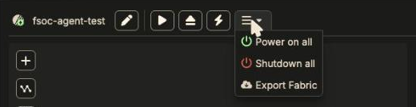
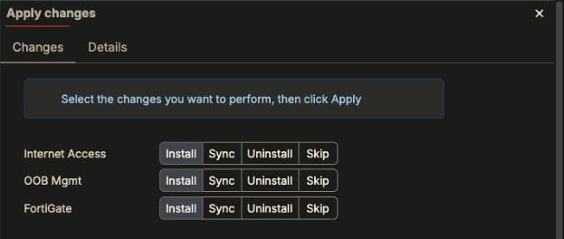
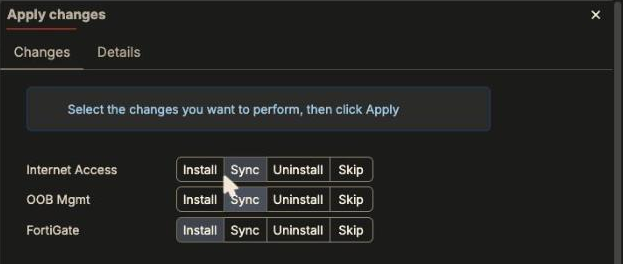
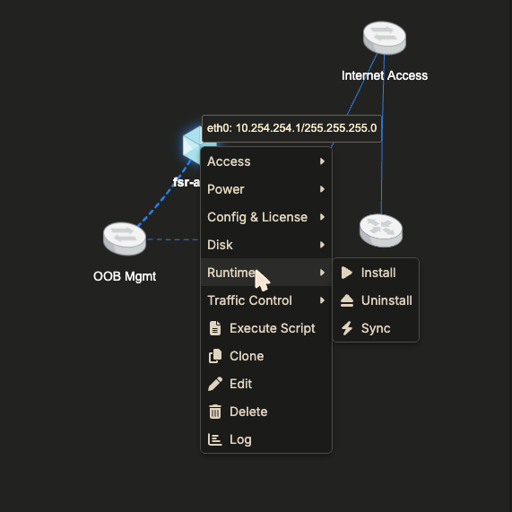
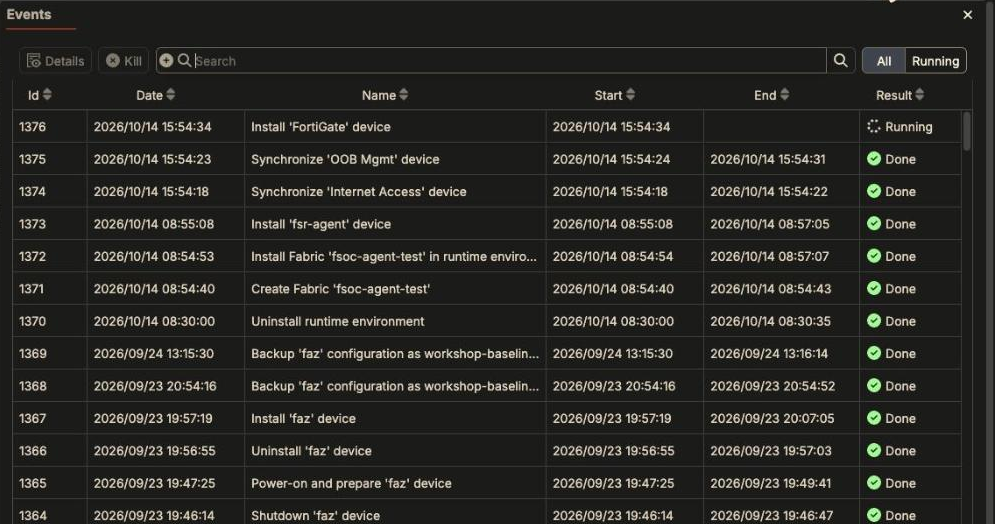
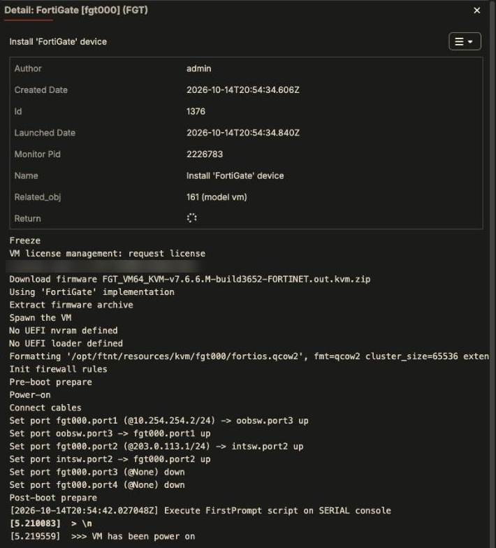

Editing a fabric only changes its *model*. Nothing happens to running devices
until you push the change, and the button you push it with decides whether
running devices keep their state.

## The fabric toolbar

| Button | What it does | Running devices |
|---|---|---|
| ✏️ **Edit** | Fabric-level settings (name, description, …). | Untouched. |
| ▶ **Install** | Installs the **whole** fabric. | **Every device is redeployed from its firmware. Guest state is lost** (config not backed up, files, licenses that must be re-activated). |
| ⏏ **Uninstall** | Removes the fabric's runtime (all VMs). The model stays. | Destroyed. |
| ⚡ **Apply changes** | Pushes only what changed since the last install. The badge counts pending items. | Only the items you choose (see below). |
| ☰ menu | **Power on all**, **Shutdown all**, **Export Fabric**. | - |

{}
**Anything you configured inside a device is lost on reinstall unless you backed
it up.** See [Saving State]({}).
{}

{}
**On a running fabric, use ⚡ Apply changes, not ▶ Install.** Install is the
first-bring-up button. Clicking it to "publish" a small change reinstalls every
device in the fabric.
{}

## Apply changes: check every row

Apply changes lists each touched item with four choices: **Install**, **Sync**,
**Uninstall**, **Skip**. **Rows often default to Install**, including switches
you only plugged a new cable into. Some edits to an existing device default to
Sync. Check every row either way.

Pick per row:

| Item | Choose | Why |
|---|---|---|
| A **new** device | **Install** | It has no VM yet. |
| A switch you only added a cable to | **Sync** | Sync wires the new port into the running switch. Install rebuilds the switch. |
| A **running** device you only added a cable to (e.g. the FortiGate) | **Sync** | Install redeploys and re-licenses it. |
| An existing device whose settings you edited | **Sync** first, unless it's on the list below | Pushes the model change (cables, accesses) without redeploying. Passwords, gateway/DNS and new port addresses need Install (see below). |
| Something you're not ready to push | **Skip** | It stays pending. |

In the example above, the two switch syncs finished in about 5 seconds each and
the FortiGate install in about 3 minutes. The already-running LXC on the same
switches was not touched.

The **Details** tab shows the full JSON of every object being changed.

{}
**Don't screenshot or share the Details tab.** It shows the fabric's device
password and maintainer email in plain text.
{}

## Per-device actions

Right-click a device, **Runtime**:

- **Install** redeploys only this device (its guest state is lost).
- **Uninstall** destroys only this device's VM.
- **Sync** pushes model changes to this device without redeploying it.

Other useful submenus:

- **Power**: Power On, Shutdown, Force Off.
- **Config & License**: Backup Config, Restore Config, Reload License.
- **Disk**: Backup as Firmware (turns the current disk into a reusable firmware image).

## Changes that need more than Sync

Some settings are only applied when a device is installed, so Sync alone won't
change a running device:

- **A new port's address inside the guest.** Cabling a running FortiGate to a
  new switch and syncing it connects the cable and records the address
  (e.g. port3 `10.1.1.1`) in Fabric Studio, but FortiOS still has no IP on
  port3. Configure it in FortiOS yourself, or reinstall the device.
  [Example]({}).

- **Gateway / DNS** from a device's **Network Parameters**: Fabric Studio
  writes them into the guest during install. Changing them, or the network's
  gateway or DNS, does not update an already-running guest; reinstall the
  device (back up its configuration first). **Apply changes offers Sync for
  this, and Sync is a trap:** it finishes without error and clears the pending
  item, so nothing looks outstanding, but the guest is untouched (tested on an
  LXC: same default route, same `resolv.conf`). Exception: on a FortiGate with a
  saved configuration the configuration file wins and Network Parameters are
  never applied. LXC devices always take them from Network Parameters.
  [Details]({}).
- **Passwords**: the device login password and the **Display Password** are
  applied when the device is installed. A new Display Password is not applied
  by Sync (confirmed); reinstall the device. See
  [Logins and passwords]({}).
- **DHCP served by Fabric Studio** (a port set to **Addressing mode: DHCP**
  with a **Native DHCP Server**): the lease lives on the **System Host** (or
  router), and only an **Install of the System Host** rewrites it. Sync of the
  System Host or the device leaves the old lease. You don't need to reinstall
  the device; reboot it or renew its lease. When Apply changes offers Install
  on the System Host, keep it. Proven step by step on
  [a generic VM]({}).
- **VLAN mode / tags on a switch port**: Sync updates the switch's settings, but
  traffic keeps flowing on the old VLANs until the switch itself is reinstalled
  (Runtime > Install on the switch). Reinstalling a switch does not reinstall the
  devices cabled to it.

## Watch progress in Events

Every action is a background task. Open the task list (the list icon at the top
right) to see them:

Select a task and click **Details** to watch its log live. A device install
log shows each step: spawning the VM, connecting each cable, licensing, then
applying addresses, routes and DNS.

{}
Install logs echo device passwords in plain text. Don't paste them into tickets
or chats.
{}

## One running fabric per Fabric Studio

A Fabric Studio runs one fabric at a time. Installing fabric B first uninstalls
the runtime of whichever fabric is running. Fabric A's model stays, but its VMs
are gone. Back up anything you need before switching.
