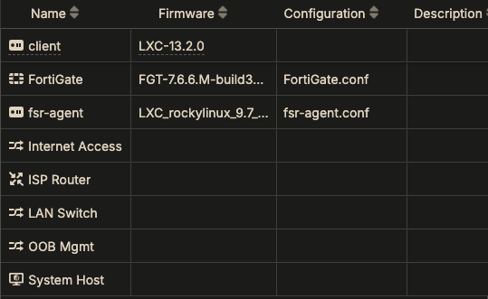
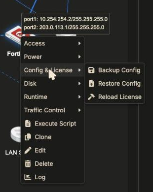
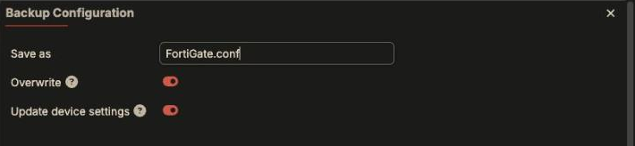
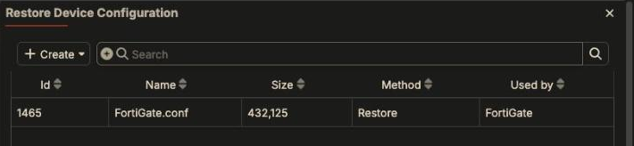
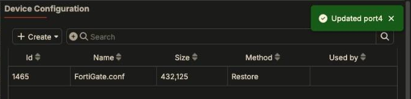

Fabric Studio deploys a device from two things: its **firmware** and, if set,
its **configuration** file. Anything you change *inside* a running device
(FortiOS interfaces, policies, a Linux package you installed) lives only in that
VM's disk. Fabric Studio doesn't know about it.

**Any reinstall throws those changes away**: the fabric ▶ Install button,
**Runtime > Install** on the device, an Apply changes row left on Install, or
switching to another fabric and back. The device comes back from firmware plus
its saved configuration. With no saved configuration, it comes back as factory
defaults plus the addressing Fabric Studio applies from its model (see
[the table below](#what-fabric-studio-configures-by-itself-fortigate)).

## Check: does the device have a saved configuration?

Look at the **Configuration** column in the device table:



An empty Configuration means a reinstall returns the device to factory
defaults plus what Fabric Studio configures itself (addresses, default route,
DNS, license).

## Back up a device

1. Right-click the device, **Config & License > Backup Config**.

   

2. In the dialog:

   

   | Field | Set to | Meaning |
   |---|---|---|
   | **Save as** | e.g. `FortiGate.conf` | The file name stored on Fabric Studio. |
   | **Overwrite** | on | Replace an existing file with the same name. |
   | **Update device settings** | **on** | **Makes this file the device's configuration**, the one restored on every install. Leave it off and the backup is just a file nobody uses. |

3. Click **OK**. You'll see *Backup Config succeeded*, and after a refresh the
   Configuration column shows the file name.

{}
**The device must be powered on** to back it up: Fabric Studio pulls the
config from the running device. Back up *before* you shut down, uninstall, or
reinstall, not after.
{}

## Proof: a reinstall restores the backup

In the [LAN example]({}),
port3's address and the LAN-to-Internet policy were typed into FortiOS by hand.
Fabric Studio doesn't configure either. After **Backup Config** (with
*Update device settings* on), the FortiGate was reinstalled with **Runtime >
Install**. The install log shows the new step, after licensing:

```text
Connect to TFTP server 10.254.254.254 ...
Get file from TFTP server OK.
File check OK.
'TFTPRestore' completed
Execute WaitReboot script on SERIAL console
```

After the reboot, both hand-made changes were back, the license was still
Valid, and the client behind it still reached the internet:

```text
# show system interface port3        # show firewall policy
    edit "port3"                          edit 1
        set ip 10.1.1.1 255.255.255.0         set name "LAN-to-Internet"
                                              set srcintf "port3"
                                              set dstintf "port2"
                                              set nat enable
```

A reinstall with a restore takes about 4 minutes for this FortiGate, against
3 for a plain one, because the device reboots once more to load the
configuration.

## What Fabric Studio configures by itself (FortiGate)

Tested on the same FortiGate. The two install modes behave very differently:

| | Install **without** a saved config | Install **with** a saved config | **Sync** |
|---|---|---|---|
| port1 address (management) | yes | yes | no |
| License (via a temporary route over OOB Mgmt) | yes | yes | no |
| **Data port addresses from the model** | **yes, every port that has an address, cabled or not** | **no** | **no** |
| `allowaccess` | `ping` on data ports, `http https ping ssh` on port1 | from the config file | no |
| Default route + DNS from Network Parameters | yes | **no** | no |
| Firewall policy, VDOMs, objects, admin settings | **never** | from the config file | no |
| Restore the config file + reboot | - | yes | no |

What this means in practice:

- **Model port settings alone give you addressing, not a working firewall.**
  With the config detached and port4 given `192.0.2.1/24` in the model (not even
  cabled), a reinstall set port2, port3 *and* port4 and the default route. But
  there was no policy, so the LAN client could ping the FortiGate and nothing
  beyond it.
- **Once a device has a saved config, the config wins.** Fabric Studio no
  longer pushes model port addresses, gateway or DNS on install. It licenses
  the device and restores the file. Change an address in the model of a device
  with a saved config and reinstall, and the change does **not** reach FortiOS.
  Change it in FortiOS and back up again.
- **Sync never touches FortiOS.** Its log records the new port address and
  moves on.

{}
A good workflow: let a **first install** (no config) lay down addressing from
the model, add policy and the rest in FortiOS, then **Backup Config** with
*Update device settings* on. From then on, FortiOS is the source of truth and
every reinstall restores it.
{}

## When to back up

- After any change made **inside** a device that you want to keep (FortiOS
  CLI/GUI changes, Linux setup).
- **Before** clicking ▶ Install, Runtime > Install, or Apply changes with a
  running device left on Install. Runtime > Install starts immediately, with no
  confirmation.
- Before installing a different fabric on the same Fabric Studio (it
  uninstalls the running one).
- Before **Export Fabric**, so the template carries the configured state.

## Restore on demand

**Config & License > Restore Config** pushes a saved configuration onto the
running device without a reinstall. Pick the file and click **Restore**:



On the FortiGate this took about a minute: Fabric Studio runs
`execute restore config tftp` from the System Host and the device reboots. Use
it to roll a device back to its last backup. It's much faster than a
reinstall, and the license is untouched.

## Attach or detach a saved configuration

The device's **Edit > Configuration** field holds the attached file. **…**
picks one from the stored configurations (the **Used by** column shows which
device each is attached to), and **✕** detaches it without deleting the file.



Detach it when you deliberately want the next install to start clean from the
model.

## Back up a whole disk instead

For Linux guests where state lives in packages and files, not one config file,
**Disk > Backup as Firmware** saves the VM's disk as a new firmware image. New
devices (or this one, by changing its Firmware) can then be deployed from it.
