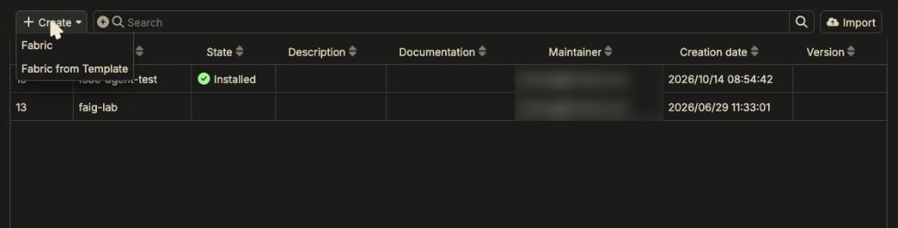
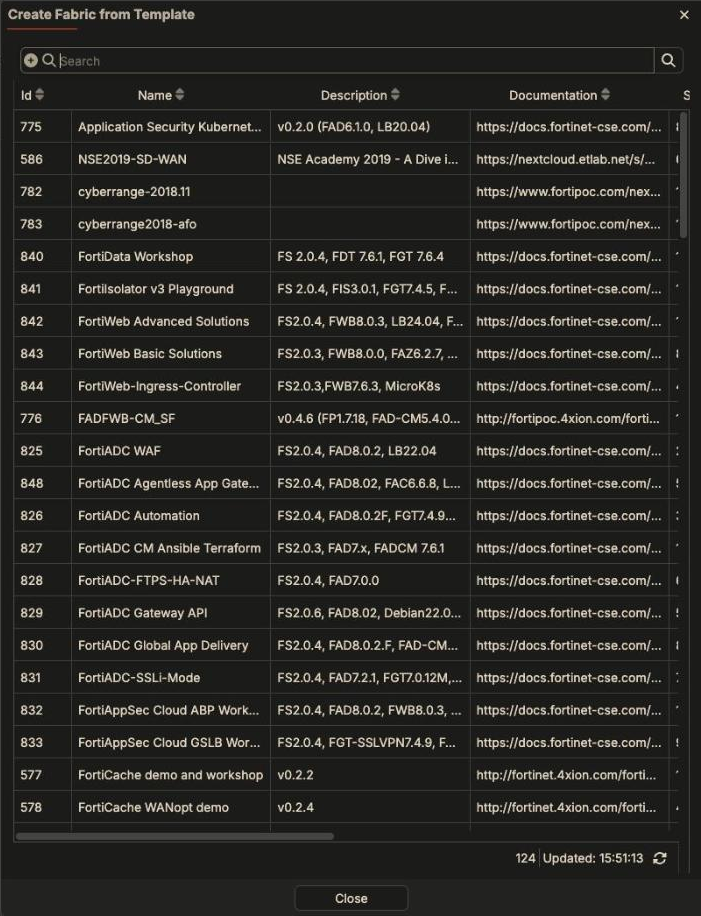
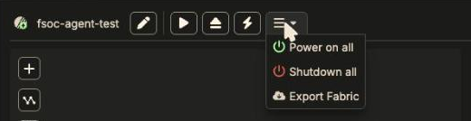
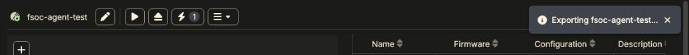
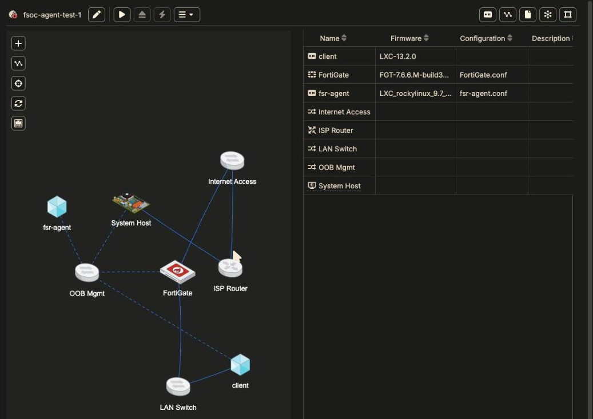
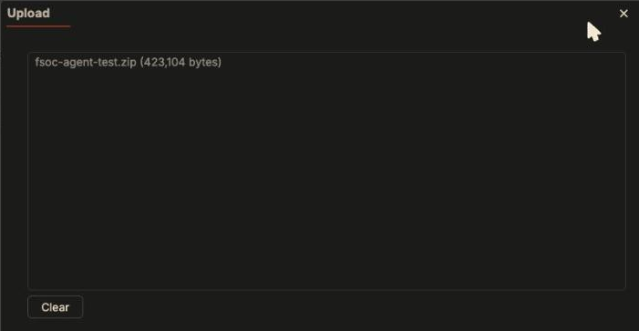
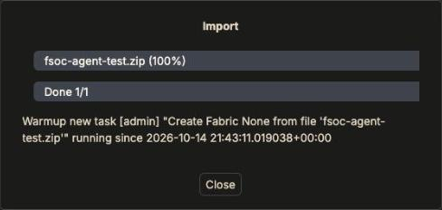

A **template** is an exported fabric: devices, cabling, networks, and
(optionally) saved device configurations. Starting from one is the fastest way
to get a working demo.

## Create a fabric from a template

1. Go to **Fabric Workspace**.
2. Click **Create > Fabric from Template**.

   

3. Pick a template from the list, then confirm.

   

Use the search box. The list holds every template your registration can
see (124 on the pod above). Two columns matter when choosing:

- **Description**: most templates state the Fabric Studio version they were
  built on and the firmware versions inside, for example
  `FS2.0.4, FAD8.0.2, FGT7.4.9`.
- **Documentation**: a link to the template's lab guide. Read it first; many
  templates expect manual steps after install.

{}
**Fabric Studio's password policy is not applied to fabrics created from a
template.** Older templates, and anything converted from FortiPoC, can ship
with weak device passwords. If your Fabric Studio is reachable from the
internet, change them before you install.
{}

## Where templates come from

Templates are served from the repositories assigned to your Fabric Studio
registration. Browse them under **Repositories > Remote**. If the list is
empty, check **System > Registration** first. See
[Deploy Fabric Studio]({}).

## Export your own fabric as a template

From the fabric's **☰** menu, choose **Export Fabric**.

There's no dialog. Fabric Studio shows *Exporting <fabric>…* and your browser
downloads `<fabric>-<version>.zip` (for example `fsoc-agent-test-0.0.0.zip`).

The zip is small, because it holds the model and configurations, not disk
images:

| File | What it is |
|---|---|
| `fabric.cfg` | The whole model: networks, switches, routers, devices, ports, cables, plus the firmware each device uses (by file name and checksum, not the image). |
| `layout/1.json` | Device positions in the topology view. |
| `config/1/<TYPE>/<name>.conf` | Each device's **saved configuration** (see [Saving State]({})). |
| `meta/*.meta` | The firmware descriptions, so the importing Fabric Studio can match images. |

Before exporting:

- **Back up each device's configuration** (right-click **Config & License >
  Backup Config**, with *Update device settings* on). The export only carries
  what's in the Configuration column. Changes that only live inside a
  running device are not exported.
- **Know what you're sharing.** `fabric.cfg` holds the fabric's device
  password and the maintainer's email in clear text, and a FortiGate
  configuration backup is a full FortiOS config. Licenses are never exported.

## Download our example fabric

[**fsoc-agent-test.zip**](fsoc-agent-test.zip) (413 KB) is the fabric used
throughout this chapter, exported from Fabric Studio 2.2.35:

| Device | Firmware | Saved configuration |
|---|---|---|
| FortiGate | FortiGate-VM 7.6.6 (`fortinet` repository) | `FortiGate.conf`: port3 `10.1.1.1/24` and the `LAN-to-Internet` NAT policy from [A LAN behind a FortiGate]({}) |
| client | Debian 13 toolbox LXC (`third-party` repository) | none; gets `10.1.1.2` and its default route from the LAN network |
| fsr-agent | Rocky Linux 9.7 docker LXC (a **home** repository image) | `fsr-agent.conf` |
| LAN Switch | | LAN network `10.1.1.0/24`, gateway `10.1.1.1`, DNS `8.8.8.8` |

### Import it

1. Download the zip.
2. Go to **Fabric Workspace** and click **Import** (top right).
3. **Select files**, pick the zip, and click **OK**.

   

4. Wait for *Done 1/1*, then **Close**.

   

The fabric appears in the Fabric Workspace list, **not installed**. If a
fabric with the same name already exists, the import gets a suffix
(`fsoc-agent-test-1`). Importing only creates the model. It doesn't stop or
touch the fabric that's currently running.

### Before you install it

- **Firmware.** The FortiGate and client images come from the public
  `fortinet` and `third-party` repositories and download on first install.
  The **fsr-agent** image is from our home repository and won't exist on your
  Fabric Studio: delete that device, or point its **Firmware** at an LXC image
  you have.
- **License.** The FortiGate is on **License: Automatic** and licenses from
  your own FortiFlex or .lic files. See
  [Device Licensing]({}).
- **Password.** The fabric's device password is the one we used. Change it in
  the fabric's ✏️ **Edit** before installing, especially if your Fabric Studio
  is reachable from outside.
- **It replaces your running fabric.** Installing stops whatever fabric is
  running now. Back that one up first.

Then click ▶ **Install** (it's a fresh fabric, so a full install is right) and
check it the same way as [Your First Fabric]({}),
plus `ping 8.8.8.8` from the client.
