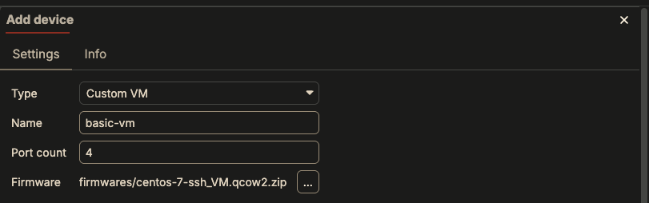
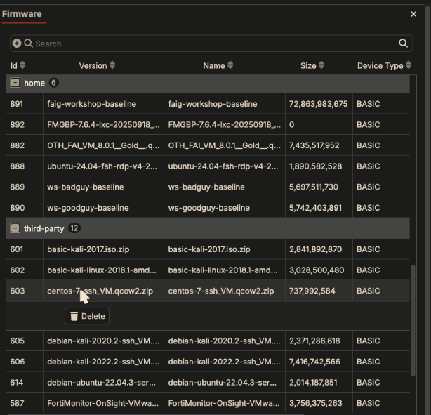
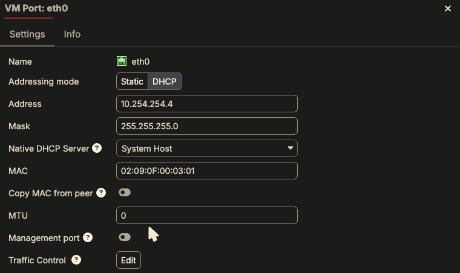
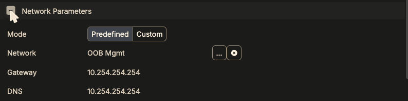

Any disk image that isn't a supported Fortinet product (a Linux server, a Kali
box, a third-party appliance) runs as a **generic VM**. The UI calls it
**Custom VM**; the API and firmware metadata call it **BASIC**.

Fabric Studio boots the image and cables it, and **does nothing inside the
guest**: no address, no gateway, no password, no license, no config backup.
Whatever the image does on boot is what you get. Most surprises with generic
VMs come from expecting the Fortinet-device behaviour.

*Verified on Fabric Studio 2.2.35 with the `centos-7-ssh_VM.qcow2.zip` image
from the third-party repository.*

## Add one

1. **+ > Add device**, Type **Custom VM** (search for "custom" or "basic").
   Set the number of ports.

   

2. Pick the **Firmware**. Any firmware whose *Device Type* is **BASIC** works:
   the images in the **third-party** repository, or your own image in
   **home**.

   

3. Cable it and set its port addressing (next section) **before** the first
   install.

Your own image: upload the `.qcow2` (or a `.zip` of it) to the Fabric Studio's
`firmwares/` directory, then publish it to the home repository:

```bash
scp -O my-image.qcow2 admin@<fabric-studio>:firmwares/
ssh admin@<fabric-studio> system repository home package my-image.qcow2
```

The image must bring its NICs up with **DHCP**. Fabric Studio's built-in help
says so for every third-party image ("Supported Devices > Third-party
devices").

## What an install does

From the install log:

| Step | Generic VM |
|---|---|
| License | `No license required` |
| Firmware | Downloaded from the repository on first use (738 MB in about 40 s), then cached |
| Disk | A **new** copy-on-write disk on top of the firmware. Every install starts from the clean image: **guest changes are lost** |
| Pre-boot / post-boot prepare | Run, but do nothing for a generic VM |
| Addresses, gateway, DNS | **Not pushed into the guest** |
| Password | **Not set**. See [Logging in](#logging-in) |
| Backup Config | No `/fabric` hooks in the guest, so there's nothing to back up. Save the disk instead: [Back up a whole disk]({}) |

## Getting it an address: use the native DHCP server

Cabling a port fills in an **Address** in the port's settings, just like for a
FortiGate. For a generic VM **that address is never configured in the
guest.** With the defaults, the VM boots, asks for DHCP, gets no answer, and has
no IP at all: no ping, no SSH, nothing on the switch but DHCP requests.

Have Fabric Studio serve that address over DHCP instead:

1. Open the device, **Ports**, click the port (e.g. `eth0`).
2. **Addressing mode: DHCP**. Keep the **Address** and **Mask**: Fabric
   Studio hands out exactly that address (a static lease for the port's MAC).
3. **Native DHCP Server**: the native device on that port's network. For
   **OOB Mgmt** that's the **System Host** (the one tested here). The list
   only offers native devices: the **System Host** and the **ISP Router**.

   

4. Click **OK** (the port is saved right away), **OK** on the device, then
   **⚡ Apply changes** with **Install on the System Host** (or that router).
   See the warning below.

The guest picks up the lease on its next DHCP attempt. The test image kept
retrying every few seconds; if yours gives up, reboot it.

{}
**DHCP changes need the System Host (or router) Installed, not Synced.**
The DHCP server's leases are only rewritten when the **System Host** itself is
installed. Sync, of the System Host or of the VM, leaves the old lease (or no
lease) in place. Tested one change at a time: two System Host Syncs never
served the new lease, and a System Host Install alone, without touching the VM,
did. Apply changes usually pre-selects Install on the System Host for these
changes; don't switch it to Sync to "be safe".

Installing the System Host is quick (about 15 s) and doesn't reinstall any
device, but it briefly bounces the fabric's management and ISP links and
flushes connection tracking. Open SSH/console sessions through Fabric Studio
drop.
{}

A port on a switch with no native device (a LAN switch whose gateway is a
FortiGate, for example) has no native DHCP server. Run a DHCP server on that
network (FortiGate, LXC), set the port to DHCP and leave **Native DHCP Server**
empty, or configure a static address inside the guest.

### Gateway and DNS

The lease also carries the device's **Network Parameters**, with one rule:

- **DNS** is always included.
- The **gateway** is included only if it's in the **same subnet** as the
  DHCP-served port.

So a VM whose only DHCP port is on OOB Mgmt (`10.254.254.0/24`) but whose
Network Parameters point at a LAN (gateway `10.1.1.1`) gets an address and the
LAN's DNS, but **no default route**. It can't reach the internet, and DNS fails
too.

For internet access through the management network, set the device's
**Network Parameters** to **Predefined**, network **OOB Mgmt** (gateway and DNS
`10.254.254.254`), then Install the System Host:



Verified: the guest got `default via 10.254.254.254`, nameserver
`10.254.254.254`, and HTTPS out worked.

## Logging in

The fabric password is **not** applied to a generic VM. The login is whatever
the image was built with. Third-party images record it in their firmware
metadata (a `credentials` entry with a login and password). In the test,
`root` plus the fabric password was refused, and `root` plus the image's
password worked.

For your own image, use the login you built it with.

The **Desktop/VNC** console works without any network setup, which makes it the
quickest way to see why a generic VM isn't answering (stuck boot, no IP).

## Checklist

| Symptom | Cause | Fix |
|---|---|---|
| VM boots, no ping, no SSH | Ports left on **Static**; the guest never gets that address | Port **DHCP** + **Native DHCP Server**, Install the System Host |
| Changed DHCP / Network Parameters, nothing changed in the guest | System Host was Synced, not Installed | Install the System Host, then reboot or renew in the guest |
| Has an IP, no internet, `Could not resolve host` | Network Parameters gateway isn't on the DHCP port's subnet | Network Parameters = the DHCP port's network (e.g. OOB Mgmt) |
| SSH refused with the fabric password | Generic VMs keep the image's own login | Use the image's credentials |
| Changes inside the VM gone after an install | Every install starts from the clean image | **Disk > Backup as Firmware** first |
