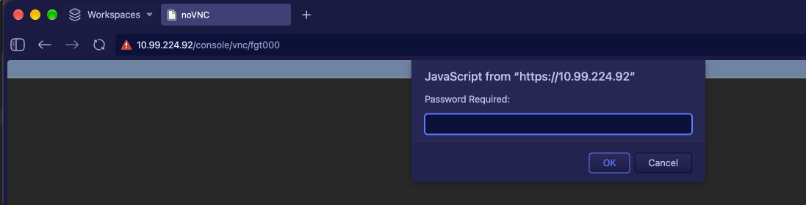
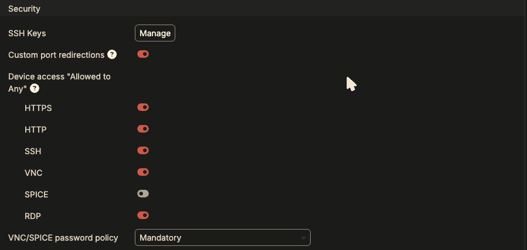

If you cannot SSH to a device from outside the Fabric Studio native console, SSH access may be disabled at either the global or device level.

If the connection opens but the login is refused, check the username and
password first: `admin` with the fabric password, unless the device has its
own password set. See
[Logins and passwords]({}).

## Understanding SSH Access Levels

**Global Settings Impact:**
- By default, SSH access via public internet is **disabled**
- **Admin & Guest** setting means you **must** be logged into the Fabric Studio web frontend to access devices via SSH web frontend

## Global Settings Configuration

First, verify SSH access is enabled at the system level:

1. Navigate to **System > Settings** in Fabric Studio
2. Ensure both **HTTPS** and **SSH** ports are enabled


## Device Level Configuration

After confirming global settings, configure device-specific access:

### Step 1: Access Device Configuration
1. In the Fabric configuration, **right-click** your device
2. Select **Edit** from the context menu


### Step 2: Modify Access Settings
1. Scroll down to the **Access** section
2. **Expand** the Access section
3. Change both **HTTPS** and **SSH** settings:
   - From: `Admin & Guest`
   - To: `Any`


## VNC (graphical console) access

The **Desktop/VNC** button on a device opens its graphical console in a
browser tab, at `https://<fabric-studio>/console/vnc/<nameid>` (for example
`/console/vnc/fgt000`). When it asks for a password, that's the device's
**Display Password**:



By default (VNC access **Admin & Guest**) that page only works for someone
logged in to Fabric Studio. Once VNC is **public** (the four steps below), the
same link works **without a Fabric Studio login**: anyone with the URL and the
Display Password gets the console. That's a convenient way to give a workshop
attendee one device's screen without a Fabric Studio account, and also the
reason the password matters.

The four steps also open the raw VNC port for a desktop VNC client, at
`14000 + the device's port index` (e.g. `14001`). All four must be true:

1. **System > Settings > Device access "Allowed to Any": VNC** is on. It's off
   by default.

   

2. The device's **Edit > Access > VNC** is set to **Any**. This change is saved
   as soon as you pick it, before you click OK.
3. The device (or the fabric) has a **Display Password** of **exactly 8
   characters**. See below.
4. The device has been **reinstalled** since the password was set
   (Runtime > Install). A Sync doesn't apply a new Display Password.

### The Display Password must be exactly 8 characters

VNC only uses the first 8 characters of a password. With the default
**VNC/SPICE password policy: Mandatory** (System > Settings), a longer Display
Password doesn't count as valid, and Fabric Studio silently treats the access
as Admin & Guest: no public VNC port. The password policy (minimum 8
characters, mixed types) applies to display passwords too, so in practice the
Display Password must be **exactly 8 characters**. The device's install log
shows the failure:

```text
The VNC password has been truncated per VNC specification
No valid password for VNC, public access not allowed
```

With an 8-character password the same install logs
`Adding firewall access rule for VNC`, and the port answers. (The "truncated"
line appears either way; the second line is the one that matters.)

Where the Display Password comes from: the device's **Edit > Advanced >
Display Password**, or, if that's empty, the fabric's ✏️ **Edit > Advanced >
Display Password**. See
[Logins and passwords]({}).

The same settings from the Fabric Studio CLI:

```bash
system security preferences set '{"console": {"vnc_public_allowed": "yes"}}'
model vm access update <ACCESS_ID> '{"mode": "PUBLIC"}'
model vm update <VM_ID> '{"console_password": "<8 characters>"}'
```

To keep a longer Display Password, set the policy to accept its first 8
characters, as long as those 8 pass the password policy on their own. The UI
offers only Mandatory and Optional; this one is CLI-only:

```bash
system security preferences set '{"console": {"public_password": "truncated"}}'
```

(**Optional** allows public VNC with no password at all. Only use it behind
something else that controls access.) Full details: **VNC and SPICE** in your
Fabric Studio's built-in help, `https://<fabric-studio>/help/security.html#vnc-and-spice`.

{}
**Additional Resources:** For comprehensive information on Security Policies, visit the [Fabric Studio Documentation](https://register.fabricstudio.net/docs/fabric-studio/2.2.35/security.html#ssh-access-to-device) (sign-in required), or `https://<fabric-studio>/help/security.html` on your own Fabric Studio.
{}
