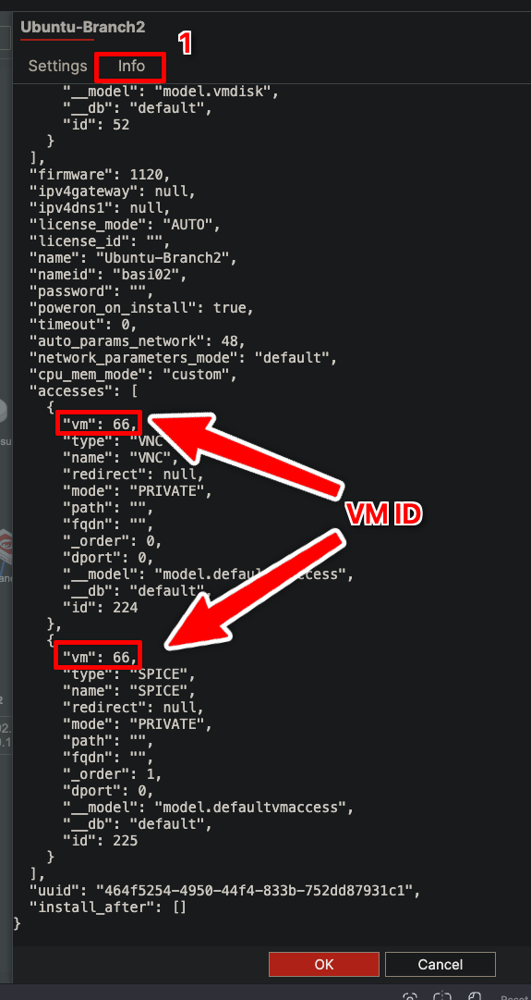
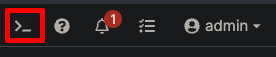
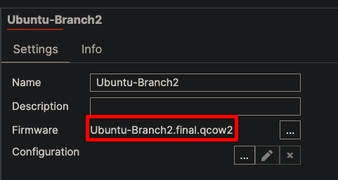
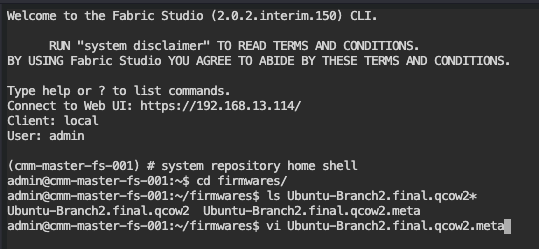
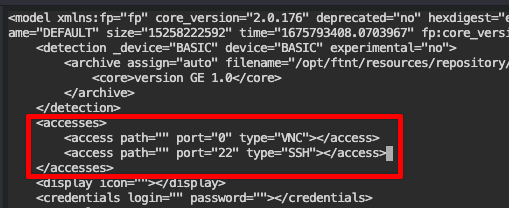
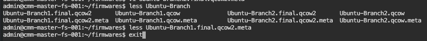
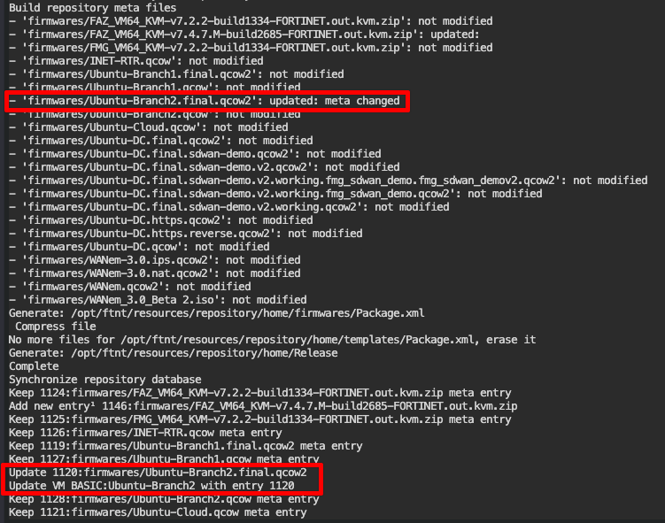
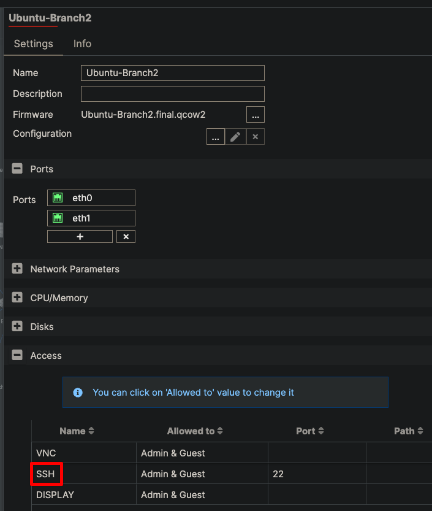
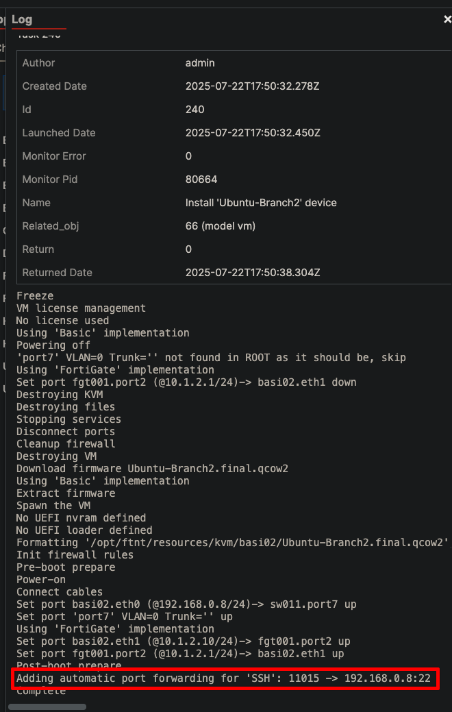

If SSH, HTTP, or HTTPS isn't available in a device's Access section, there are two
different ways to add it — and picking the wrong one costs you a lot of time.

| You want to… | Do this |
|---|---|
| Add access to **one existing VM** | Use the CLI: [VM Access]({}). One command, no image changes, no repository refresh. |
| Add access to **every future VM built from a firmware image** | Edit the image's `.meta` file — the procedure below. |

**For a single device, use the [VM Access]({})
page.** `model vm access create` adds the entry directly to the VM model. The
`.meta` procedure below edits the *firmware image*, so it only affects VMs
deployed from that image afterwards — it is not the quick fix for one device.

## Add access to one device (CLI)

If HTTPS is missing from a single device's Access section, add it from the CLI —
no image edit and no repository refresh needed.

### Initial Assessment

When HTTPS is not listed in the Access section:


### Step-by-Step Process

#### Step 1: Locate VM ID

You can read it from the UI — click the **Info** tab, scroll to the **JSON
format** of access settings, and note the **VM ID** from the `vm` field
(example: `66`):



Or list it from the CLI, where the first column is the VM ID:

```bash
(cmm-master-fs-001) # model fabric vm list 5
40 fgt1 [fgt000] (FGT)
41 lxc1 [lxc000] (LXC)
```

#### Step 2: Access SSH Interface
Click the **SSH** button in Fabric Studio:



#### Step 3: Create HTTPS Access
Execute the following command, replacing `66` with your actual VM ID:

```bash
(cmm-master-fs-001) # model vm access create '{"vm": 66, "type": "HTTPS", "mode": "PUBLIC", "name": "HTTPS", "dport": 443}'
115 HTTPS PUBLIC access to lxc1 from 13001 to 443
```

{}
**Use `"mode": "PUBLIC"`, not `PRIVATE`.** A `PRIVATE` entry is created
successfully and appears in every listing, but it isn't a public port: HTTPS
only answers while you're logged in to the Fabric Studio web UI, and SSH/HTTP
get no external port forward at all. `PUBLIC` is what lets you connect from
your own tools (the matching global setting in **System > Settings** must
allow it too).
{}

#### Step 4: Sync the device

The entry is in the model, but nothing is listening until you push it to the
running device:

```bash
(cmm-master-fs-001) # runtime vm synchronize 66
558 [admin] "Synchronize 'lxc1' device" running since 2026-07-16 18:03:18+00:00

(cmm-master-fs-001) # task detail 558
558 "Synchronize 'lxc1' device" ends with 0 code
```

Then connect on the port from the create output — `https://<pod-host>:13001` above.

For the full reference — access types, `HTTPS2HTTP` for plain-HTTP guests, the
pod-wide security gate, and updating or deleting entries — see
[VM Access]({}).

## Bake access into a firmware image

Use this when you want the access type present by default on every VM deployed
from an image.

### Prerequisites

Before proceeding, note your device's firmware name. In this example: `Ubuntu-Branch2.final.qcow2`



### Step-by-Step Process

#### Step 1: Access CLI
Open the CLI interface in Fabric Studio.

#### Step 2: Navigate to Firmware Directory
```bash
system repository home shell
cd firmwares/
```

#### Step 3: Edit Meta File
Replace `<firmware-name>` with your actual firmware name:
```bash
vi <firmware-name>.meta
# Example: vi Ubuntu-Branch2.final.qcow2.meta
```



#### Step 4: Add SSH Access Entry
1. Use arrow keys or press `j` to navigate to the **accesses** section
2. Position cursor on the **VNC access line**
3. Press `o` to create a new line below VNC
4. Paste the following line:
   ```xml
   <access path="" port="22" type="SSH"></access>
   ```

You should now see two access entries:



#### Step 5: Save Changes
1. Press `ESC` to exit insert mode
2. Type `:wq` (write and quit)
3. Press `Enter` to confirm

#### Step 6: Verify Changes (Optional)
```bash
less <firmware-name>.meta
# Press 'q' to exit viewer
```

#### Step 7: Return to Main Shell
```bash
exit
```



### Repository Synchronization

{}
**Important:** After modifying meta files directly, you **must** inform Fabric Studio of changes by performing a repository sync.
{}

#### Refresh Repository
```bash
system repository home refresh
```

The refresh command will display changes made to your firmware's meta file:



### Verify and Apply Changes

#### Step 1: Confirm UI Changes
1. Navigate back to the Fabric Studio UI
2. **Refresh** the page
3. Open the modified device
4. Confirm **SSH** is now available in the Access section



#### Step 2: Sync Device Configuration
The meta file changes won't take effect on installed fabrics until you perform a device sync:

1. Initiate a **Sync** on the device
2. During sync/install, verify that Fabric Studio creates a port forward for SSH


