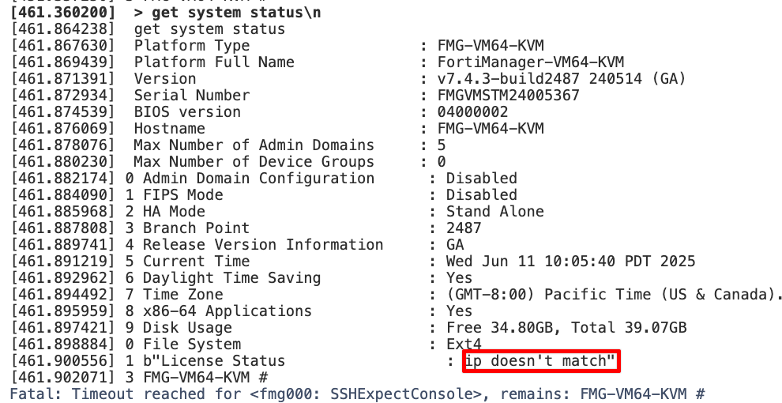

## Overview

This guide addresses the common issue where deployment fails due to "ip doesn't match" license error in Fabric Studio. The root cause is typically that the license lacks a management IP address (`mgmt_addr`), preventing proper license validation during VM initialization.

## Problem Symptoms

### Primary Error

`License Status: ip doesn't match`


### Secondary Indicators

- FMG device fails to install/complete within expected timeframe
- Only one interface (port1) is configured during deployment
- License validation fails during VM boot process
- Deployment timeout errors in Fabric Studio logs

## Root Cause 

**Issue**: Fabric Studio configures minimal network settings by default, setting only the management IP. Without a license IP (`mgmt_addr`) attached to the license object, the FortiManager cannot properly validate its license against the configured network interface.

**Solution**: Update the license with the appropriate management IP address so Fabric Studio can configure both the management port and license port correctly.

## Step-by-Step Resolution

### Step 1: Enable CLI JSON Mode

```bash
cli json enable
```

### Step 2: Identify the License

First, locate your license details:

```bash
system license detail <LICENSE_ID>
```

Example:

```bash
system license detail FMGVMSTM24005367
```

### Step 3: Verify Current License State

Check that `mgmt_addr` is currently `null`:

```json
{
  "object": {
    "mgmt_addr": null,
    "name": "FMGVMSTM24005367",
    "lic_type": "FMG",
    "vm_type": "FMG"
  }
}
```

### Step 4: Update License with Management IP

Use the `system license update` command to add the management IP:

```bash
system license update <LICENSE_ID> '{"mgmt_addr": "<IP_ADDRESS>"}'
```

**Example:**

```bash
system license update FMGVMSTM24005367 '{"mgmt_addr": "10.100.55.12"}'
```

### Step 5: Verify the Update

Confirm the license now has the correct IP address:

```bash
system license detail FMGVMSTM24005367
```

Expected output:

```json
{
  "object": {
    "mgmt_addr": "10.100.55.12",
    "name": "FMGVMSTM24005367",
    "lic_type": "FMG"
  }
}
```

### Step 6: Redeploy VM

With the license properly configured, redeploy your FortiManager VM through Fabric Studio.

## Validation Steps

### 1. License Status Check

After successful deployment, connect to the FortiManager and verify:

```bash
get system status
```

Look for:

```
License Status: Valid
```

### 2. Interface Configuration

Verify that both management and license interfaces are properly configured:

```bash
show system interface
```

### 3. Network Connectivity

Test connectivity to the management IP:

```bash
ping <mgmt_addr>
```
