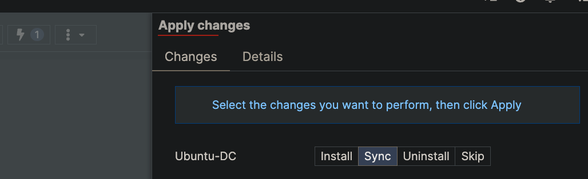

## Overview

VM access controls how you connect to a virtual machine in your fabric. Each
access entry is one protocol (SSH, HTTPS, …) on one VM, and Fabric Studio maps it
to an external port on the pod so you can reach the guest from your laptop.

Getting a working access entry is four steps, in this order:

1. **Find the fabric ID** — needed to list VMs.
2. **Find the VM ID** — every access command targets a VM by numeric ID.
3. **Create or update the access entry** — the VM ID goes inside a JSON object.
4. **Synchronize the VM** — until you do, the entry exists in the model but no
   port is actually listening.

Work through them in order and the commands below all follow.

---

## Step 1 — Find your fabric ID

Every VM lives in a fabric, and `model fabric vm list` needs the fabric's numeric
ID. List them:

```bash
(cmm-master-fs-001) # model fabric list
5 fgt-lxc-smoke
3 FortiDemo-FortiSOAR
```

The first column is the fabric ID. Here `fgt-lxc-smoke` is fabric **5** — that's
the fabric used for every example that follows.

To confirm you have the right one:

```bash
(cmm-master-fs-001) # model fabric detail 5
5 fgt-lxc-smoke
```

---

## Step 2 — Find your VM ID

This is the ID that goes in the `"vm"` field of every create command. There are
two ways to get it.

**If you know the fabric** (recommended — the output is scoped and short):

```bash
(cmm-master-fs-001) # model fabric vm list 5
40 fgt1 [fgt000] (FGT)
41 lxc1 [lxc000] (LXC)
```

Read the columns as: **VM ID**, VM name, `[nameid]`, and `(type)`. So `lxc1` is VM
**41** — the VM used in the examples below.

**If you don't know the fabric**, list every VM on the pod. Note this crosses all
fabrics, so names can repeat:

```bash
(cmm-master-fs-001) # model vm list --limit 4
20 Branch1 [fgt000] (FGT)
21 Branch2 [fgt001] (FGT)
22 Corporate_FortiMail [fml000] (FML)
23 Enterprise_Core [fgt002] (FGT)
# 1/3
```

The trailing `# 1/3` is the pagination marker — page 1 of 3. Use `--limit` /
`--page` to walk the rest. A `UnorderedObjectListWarning` on stderr here is
harmless noise from the pagination layer, not an error.

---

## Step 3 — Understand access types and modes

### Access types

| Type | Guest port (`dport`) | External port | Use it for |
|---|---|---|---|
| `SSH` | 22 | 11000 + index | Shell access |
| `HTTP` | 80 | 12000 + index | Plain-HTTP web UI (not encrypted end to end) |
| `HTTPS` | 443 | 13000 + index | A guest that terminates TLS itself on 443 |
| `VNC` | 0 | 14000 + index | Console (in-browser) |
| `SPICE` | 0 | 15000 + index | Console (in-browser) |
| `HTTPS2HTTP` | 80 | 16000 + index | A guest serving **plain HTTP** — FS terminates TLS for it |
| `RDP` | 3389 | 17000 + index | Remote desktop |
| `SERIAL` | 0 | — | Serial console (no external port) |

The **external port is the base plus the VM's port index**, not a fixed number.
That's why `fgt1` (index 0) gets SSH on 11000 while `lxc1` (index 1) gets 11001.

> **Your app is on some other port (8080, 9200, …)?** There's no access type for
> it. That's a different mechanism — see
> [Custom Ports]({}).

> **Choosing between `HTTPS` and `HTTPS2HTTP`:** if your app serves plain HTTP
> inside the guest — most containers and LXC workloads do — use `HTTPS2HTTP`.
> Fabric Studio terminates TLS with a browser-trusted certificate and proxies to
> the guest's port 80, so you get a clean `https://` URL without configuring certs
> in the guest. Use `HTTPS` only when the guest already does TLS on 443; a
> self-signed guest certificate is fine there.

### Access modes

- **PRIVATE** — reachable only inside the pod. No external port is opened.
- **PUBLIC** — Fabric Studio opens the external port so you can reach it from outside.

If you want to connect from your own machine, you want **PUBLIC**. A PRIVATE entry
is created successfully and shows up in every listing, but nothing will be
listening — this is the most common reason a new access "doesn't work".

### The pod-wide gate

A PUBLIC entry only gets its external port if the matching pod-wide flag is `yes`.
Check first:

```bash
(cmm-master-fs-001) # system security preferences get
console="vnc_public_allowed='yes' spice_public_allowed='yes' public_password='required'" password="minimum_length=8 common_check='yes' numeric_check='yes' similarity_check='no' complexity_check='yes'" lxc="dev_loop_allowed='no' dev_loop_max=8" ssh_public_allowed='yes' rdp_public_allowed='no' http_public_allowed='yes' https_public_allowed='yes' custom_rules_allowed='no' web_session_age=14700 cli_session_timeout=900
```

On this pod `http_public_allowed`, `https_public_allowed` and `ssh_public_allowed`
are already `yes`, so HTTP/HTTPS/SSH need no extra step. `rdp_public_allowed='no'`
means an RDP entry would be created but silently never get a port. Enable what you
need:

```bash
(cmm-master-fs-001) # system security preferences set '{"rdp_public_allowed": "yes"}'
```

Note `https_public_allowed` covers **both** `HTTPS` and `HTTPS2HTTP`.

---

## Step 4 — View existing access

Always look before you create — the entry you want often already exists and just
needs its mode flipped.

```bash
(cmm-master-fs-001) # model vm access list --select "vm=41"
110 Default SERIAL PRIVATE access to lxc1
111 Default SSH PRIVATE access to lxc1 from 11001 to 22
112 Default VNC PRIVATE access to lxc1 from 14001
```

The first column is the **access ID** — that's what `update` and `delete` take
(not the VM ID). Read `from 11001 to 22` as "external port 11001 forwards to guest
port 22".

Full detail for one entry:

```bash
(cmm-master-fs-001) # model vm access detail 111
111 Default SSH PRIVATE access to lxc1 from 11001 to 22
```

List every access on the pod, with pagination and ordering:

```bash
(cmm-master-fs-001) # model vm access list --order-by vm,type --limit 5
57 Default HTTP PRIVATE access to Branch1 from 12000 to 80
58 Default HTTPS PUBLIC access to Branch1 from 13000 to 443
56 Default SERIAL PRIVATE access to Branch1
61 Default SPICE PRIVATE access to Branch1 from 15000
59 Default SSH PRIVATE access to Branch1 from 11000 to 22
# 1/11
```

---

## Step 5 — Create access

The argument is a **JSON object**, single-quoted. Note this is *not* the
`key='value'` format the CLI uses when it *prints* objects — passing that back in
fails with `Expecting value: line 1 column 1`.

```bash
model vm access create '<json_object>'
```

### JSON object structure

```json
{
  "vm": <vm_id>,
  "type": "<access_type>",
  "mode": "<access_mode>",
  "name": "<descriptive_name>",
  "dport": <guest_port>
}
```

### Examples

Each returns the newly created entry, with its access ID and the external port
Fabric Studio picked.

#### HTTPS access

```bash
(cmm-master-fs-001) # model vm access create '{"vm": 41, "type": "HTTPS", "mode": "PUBLIC", "name": "HTTPS", "dport": 443}'
115 HTTPS PUBLIC access to lxc1 from 13001 to 443
```

#### HTTP access

```bash
(cmm-master-fs-001) # model vm access create '{"vm": 41, "type": "HTTP", "mode": "PUBLIC", "name": "HTTP", "dport": 80}'
114 HTTP PUBLIC access to lxc1 from 12001 to 80
```

#### HTTPS2HTTP (TLS in front of a plain-HTTP guest)

```bash
(cmm-master-fs-001) # model vm access create '{"vm": 41, "type": "HTTPS2HTTP", "mode": "PUBLIC", "name": "HTTPS2HTTP", "dport": 80}'
116 HTTPS2HTTP PUBLIC access to lxc1 from 16001 to 80
```

#### SSH access

```bash
(cmm-master-fs-001) # model vm access create '{"vm": 41, "type": "SSH", "mode": "PUBLIC", "name": "SSH", "dport": 22}'
```

#### Console types

Console types take `dport: 0` — there's no guest-side port to forward to.

```bash
(cmm-master-fs-001) # model vm access create '{"vm": 41, "type": "VNC", "mode": "PRIVATE", "name": "VNC", "dport": 0}'
(cmm-master-fs-001) # model vm access create '{"vm": 41, "type": "SPICE", "mode": "PRIVATE", "name": "SPICE", "dport": 0}'
(cmm-master-fs-001) # model vm access create '{"vm": 41, "type": "SERIAL", "mode": "PRIVATE", "name": "SERIAL", "dport": 0}'
```

---

## Step 6 — Update access (flip PRIVATE to PUBLIC)

If the entry already exists, don't create a duplicate — update it. `update` takes
the **access ID**, and you only send the fields you're changing:

```bash
(cmm-master-fs-001) # model vm access update 111 '{"mode": "PUBLIC"}'
111 Default SSH PUBLIC access to lxc1 from 11001 to 22
```

And back again:

```bash
(cmm-master-fs-001) # model vm access update 111 '{"mode": "PRIVATE"}'
111 Default SSH PRIVATE access to lxc1 from 11001 to 22
```

---

## Step 7 — Delete access

Takes the **access ID** and echoes the entry it removed:

```bash
(cmm-master-fs-001) # model vm access delete 116 --yes
116 HTTPS2HTTP PUBLIC access to lxc1 from 16001 to 80
```

> **`--yes` is not optional in a script.** Deletion is interactive by default and
> will block forever on a confirmation prompt that never renders over a
> non-interactive SSH command. Always pass `--yes` when automating.

---

## Step 8 — Apply the change to the fabric

Everything so far has only edited the **model** — the fabric's intended
configuration. The **runtime** (the actual running device) doesn't know about it
yet, so **no port is listening**. Synchronizing pushes the model onto the runtime.

Sync with the VM ID (not the access ID):

```bash
(cmm-master-fs-001) # runtime vm synchronize 41
Warmup new task [admin] "Synchronize 'lxc1' device" running since 2026-07-16 18:03:18+00:00
558 [admin] "Synchronize 'lxc1' device" running since 2026-07-16 18:03:18+00:00
```

Sync is asynchronous — it returns a **task ID** (`558` here) and works in the
background. Check it finished cleanly:

```bash
(cmm-master-fs-001) # task detail 558
558 "Synchronize 'lxc1' device" ends with 0 code
```

`ends with 0 code` means success. To see what it actually did — and this is the
best way to confirm your access entry became a real listener — read the task log:

```bash
(cmm-master-fs-001) # task log 558
Using 'LXC' implementation
Detecting changed parameters
Synchronizing ports
Synchronizing ports done
Set port lxc000.eth0 (@10.254.254.2/24) -> oobsw.port3 up
...
Synchronizing attributes
Synchronizing attributes done
Synchronizing standard accesses definition
Synchronizing standard accesses done
Synchronizing firewall
Adding HTTPS reverse proxy for 'HTTPS2HTTP'
```

Those last lines are your access entry being turned into a live listener. If a
sync fails, `task log <id>` is where the reason will be.

### Doing it from the web UI instead

Open your Fabric and sync the change to the device:



### Connect

Once synced, connect to `<pod-host>:<external-port>` — the port shown in the
create output, e.g. `https://<pod-host>:13001` for the HTTPS entry above.

> **Sync the VM, not the System Host.** `model host sync` looks similar but is a
> very different operation: it tears down **every** port forward on the pod, and
> they only come back after a full fabric install. If you only changed a VM's
> access, `runtime vm synchronize <VM_ID>` is what you want.

---

## Complete worked example

Add an HTTPS UI to the `lxc1` container, start to finish:

```bash
# 1. Which fabric?
(cmm-master-fs-001) # model fabric list
5 fgt-lxc-smoke
3 FortiDemo-FortiSOAR

# 2. Which VM?
(cmm-master-fs-001) # model fabric vm list 5
40 fgt1 [fgt000] (FGT)
41 lxc1 [lxc000] (LXC)

# 3. What's already there?
(cmm-master-fs-001) # model vm access list --select "vm=41"
110 Default SERIAL PRIVATE access to lxc1
111 Default SSH PRIVATE access to lxc1 from 11001 to 22
112 Default VNC PRIVATE access to lxc1 from 14001

# 4. Is the pod-wide gate open?
(cmm-master-fs-001) # system security preferences get
... https_public_allowed='yes' ...

# 5. Add it
(cmm-master-fs-001) # model vm access create '{"vm": 41, "type": "HTTPS", "mode": "PUBLIC", "name": "HTTPS", "dport": 443}'
115 HTTPS PUBLIC access to lxc1 from 13001 to 443

# 6. Verify
(cmm-master-fs-001) # model vm access list --select "vm=41"
110 Default SERIAL PRIVATE access to lxc1
111 Default SSH PRIVATE access to lxc1 from 11001 to 22
112 Default VNC PRIVATE access to lxc1 from 14001
115 HTTPS PUBLIC access to lxc1 from 13001 to 443

# 7. Push it to the running device
(cmm-master-fs-001) # runtime vm synchronize 41
558 [admin] "Synchronize 'lxc1' device" running since 2026-07-16 18:03:18+00:00

# 8. Confirm the sync succeeded
(cmm-master-fs-001) # task detail 558
558 "Synchronize 'lxc1' device" ends with 0 code
```

Now browse to `https://<pod-host>:13001`.

---

## JSON mode

For scripting, JSON output gives you the full object rather than the one-line
summary:

```bash
(cmm-master-fs-001) # cli json enable
(cmm-master-fs-001) # model vm access detail 111
{
  "errors": {},
  "warnings": {},
  "rcode": 0,
  "object": {
    "vm": 41,
    "type": "SSH",
    "name": "SSH",
    "redirect": null,
    "mode": "PRIVATE",
    "path": "",
    "fqdn": "",
    "dport": 22,
    "fport": 0,
    "fport_idx": 0,
    "_order": 1,
    "__model": "model.defaultvmaccess",
    "__db": "default",
    "__ignored": [],
    "id": 111
  },
  "status": "done"
}
```

Disable it again with `cli json disable`.

> **JSON mode is interactive-session only.** It's a per-session CLI setting, so it
> only applies to commands you type at the prompt after enabling it. Running
> `ssh admin@<pod> "cli json enable"` fails with
> `Fatal: <AttributeError> 'HybridMissing' object has no attribute 'pre_options'`,
> and the setting wouldn't carry to a separate `ssh` invocation anyway.

---

## Troubleshooting

| Symptom | Cause |
|---|---|
| `Expecting value: line 1 column 1 (char 0)` | You passed `key='value'` instead of JSON. Use `'{"vm": 41, ...}'`. |
| Entry exists, nothing listening | Mode is `PRIVATE`, or you haven't synced the VM (Step 8). |
| Sync task failed | `task log <id>` — it prints exactly which stage failed. |
| PUBLIC entry, still no port | The pod-wide gate is `no` — check `system security preferences get`. |
| `delete` hangs forever | Missing `--yes`; it's waiting on a confirm prompt. |
| External port isn't the base number | Correct — it's base + the VM's port index. Read the actual port from the command output. |
