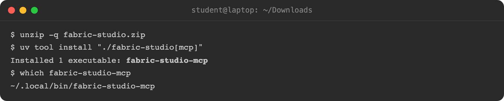
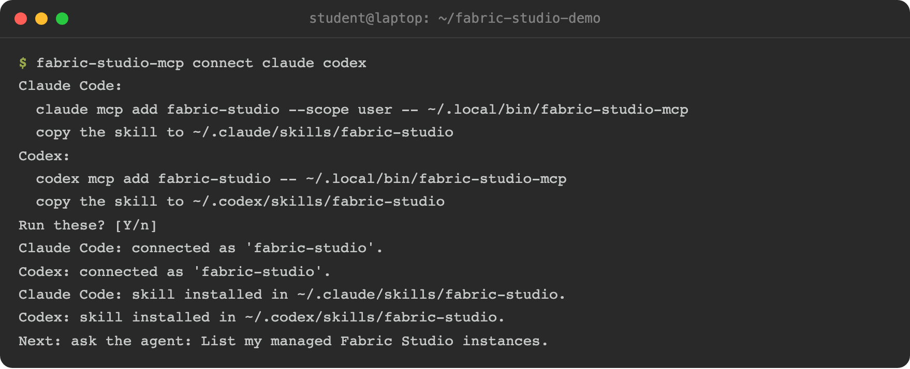

The server ships as a Python package that installs one command,
`fabric-studio-mcp`. You install it once, and Claude starts it on demand.

## Before you start

- **[uv](https://docs.astral.sh/uv/)**, which installs the command in its own
  isolated environment and fetches Python 3.11 or later if you lack it.
- **Network reach to your pods** on HTTPS 443, from the machine that runs
  Claude.

Pick your system. The choice is remembered for the rest of the page.


{}
Open a terminal (macOS uses the same commands) and install uv:

```bash
curl -LsSf https://astral.sh/uv/install.sh | sh
```
{}
{}
Open **PowerShell** and install uv:

```powershell
powershell -ExecutionPolicy ByPass -c "irm https://astral.sh/uv/install.ps1 | iex"
```

Close and reopen PowerShell so `uv` is on your `PATH`.
{}


## Install

Download the repository as a zip:

{}

{}
The zip is a snapshot. **The latest code is in the
[fabric-studio repository](https://git.fndn.fortinet.net/dspille/fabric-studio)** on the Fortinet Git server
(sign in with your Fortinet account). It always has the newest fixes and tools, so if you have access, clone it
and install from that folder instead of the zip, the same way.
{}

<!-- step: fsm09-12-install -->

Unzip it and install from the folder:


{}
From the folder the zip downloaded to:

```bash
unzip -q fabric-studio.zip
uv tool install "./fabric-studio[mcp]"
```
{}
{}
In PowerShell, from the folder the zip downloaded to (usually Downloads):

```powershell
cd $HOME\Downloads
Expand-Archive fabric-studio.zip -DestinationPath .
uv tool install ".\fabric-studio[mcp]"
```
{}


On Linux the whole install looks like this (uv also lists each package it installs; the picture keeps only the last line):

<!-- capture: fsm09-12-install -->


The server is part of **fabric-studio**, which is not on PyPI, so it installs from this download. The
`[mcp]` part adds the MCP SDK. Once it is installed you can delete the zip and the folder, but keep the folder
if you want to copy the agent skill by hand. Check the command landed on your `PATH`:


{}
```bash
which fabric-studio-mcp
```
{}
{}
```powershell
where.exe fabric-studio-mcp
```
{}


If that prints nothing, run `uv tool update-shell` and open a new terminal. uv installs tools to
`~/.local/bin` (`%USERPROFILE%\.local\bin` on Windows).

{}
Running `fabric-studio-mcp` by hand prints nothing and waits. That is correct:
it speaks MCP over stdin and stdout and expects a client. Press Ctrl+C to leave.
{}

## Connect your agent

`fabric-studio-mcp connect` adds the server to the coding agents on this machine: **FortiAgent**, **Claude Code**,
**Codex** and **opencode**. It runs each agent's own `mcp add` command, so it never edits their settings files. It
prints the exact commands first and asks before it runs them:

```bash
fabric-studio-mcp connect              # every agent it finds, asking first
fabric-studio-mcp connect claude codex # only these
fabric-studio-mcp connect --dry-run    # print the commands, change nothing
```

<!-- step: fsm09-18-connect -->
<!-- capture: fsm09-18-connect -->


- It also copies the **agent skill**, which tells an agent how Fabric Studio works (one fabric per pod, model versus
  runtime, which tool to use). Claude Code reads it from `~/.claude/skills/` and Codex from `~/.codex/skills/`;
  opencode reads Claude Code's folder, so it needs no copy of its own. Pass `--no-skill` to leave it out.
- FortiAgent imports skills in the app, so for it `connect` prints the folder to import (see
  [Connect FortiAgent](../11-connect-fortiagent/#4-add-the-fabric-studio-skill)).
- It uses the full path of the command you ran, so there is no `which fabric-studio-mcp` to copy.
- An agent that already has the server, or a skill copy you have edited, is left alone and reported. Add `--replace`
  to point it at this install and update the skill (opencode's server entry cannot be replaced from the command line:
  remove it there first).
- If an agent is not installed, it is skipped. If none is, the command prints the path to give your agent by hand.
- FortiAgent's launcher is found inside the app on macOS (`/Applications/FortiAgent.app`); set `FORTIAGENT_BIN` if yours is elsewhere.

Register a pod first with [`fabric-studio-mcp setup`](../02-connect-a-pod/); the agents start the server on demand.

## Give your agent the skill by hand

[`fabric-studio-mcp connect`](#connect-your-agent) already copies the skill. If you would rather do it yourself, or
you skipped it with `--no-skill`, the unzipped download carries it as `skills/fabric-studio/`. For Claude Code, copy
the folder into your skills folder:


{}
```bash
mkdir -p ~/.claude/skills
cp -r fabric-studio/skills/fabric-studio ~/.claude/skills/
```
{}
{}
```powershell
New-Item -ItemType Directory -Force "$HOME\.claude\skills" | Out-Null
Copy-Item -Recurse .\fabric-studio\skills\fabric-studio "$HOME\.claude\skills\"
```
{}


## Update and remove

To update, download the new zip, unzip it over the old folder, and reinstall (on Windows,
`.\fabric-studio[mcp]`):

```bash
uv tool install --force "./fabric-studio[mcp]"
```

To remove it:

```bash
uv tool uninstall fabric-studio
```

Your pod registry in `~/.fsh/` is left alone by both.

Prefer a Linux shell on Windows? WSL2 works too: run the Linux commands inside it, and run Claude Code there.

The [repository](https://git.fndn.fortinet.net/dspille/fabric-studio) has the latest code, the issue history, and a place to contribute. To update from a clone, run `git pull` and then `uv tool install --force "./fabric-studio[mcp]"` from its parent folder.

## Working from a checkout instead

If you work in the lab repository (`fabric_studio_terraform`) with its sibling projects, you don't
need the installed command. Its `.mcp.json` starts the server straight from the checkout with
`uv run python -m tools.fs_mcp.server`, so Claude Code picks it up when you open that directory. That
build also adds the device configuration phase of a build and the connector tools, which need that repository.
