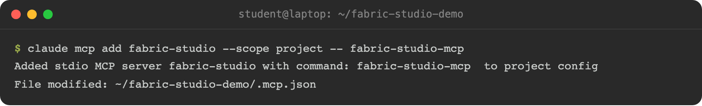
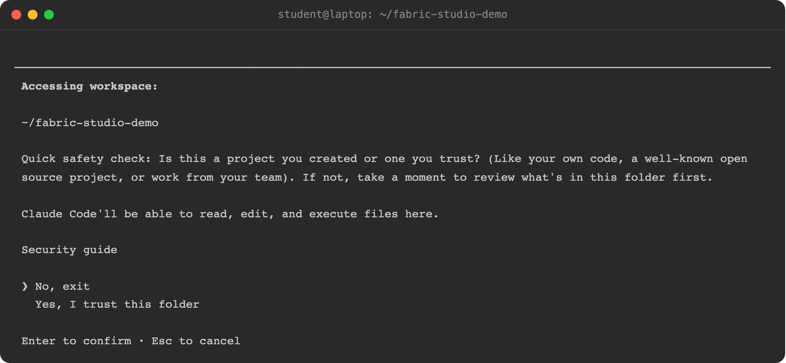
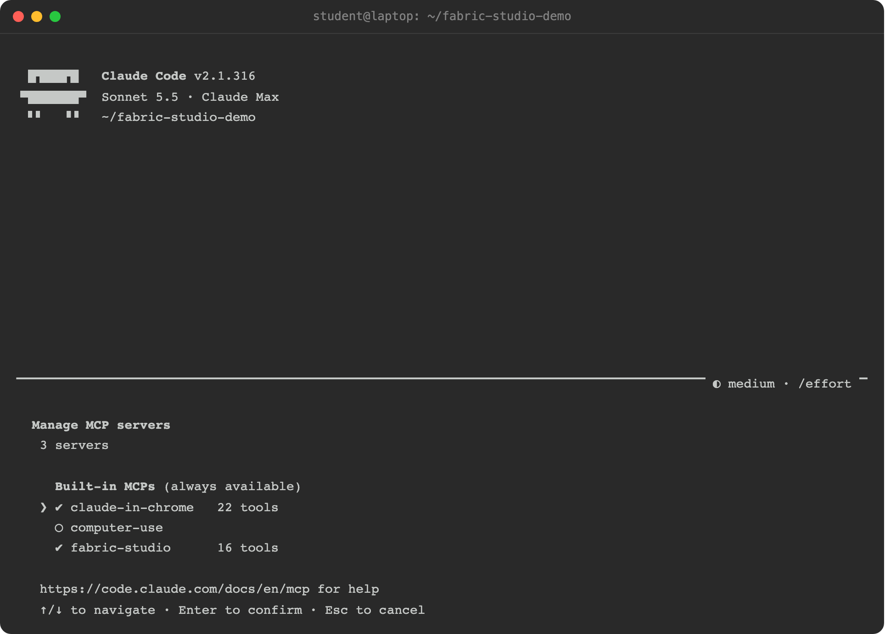
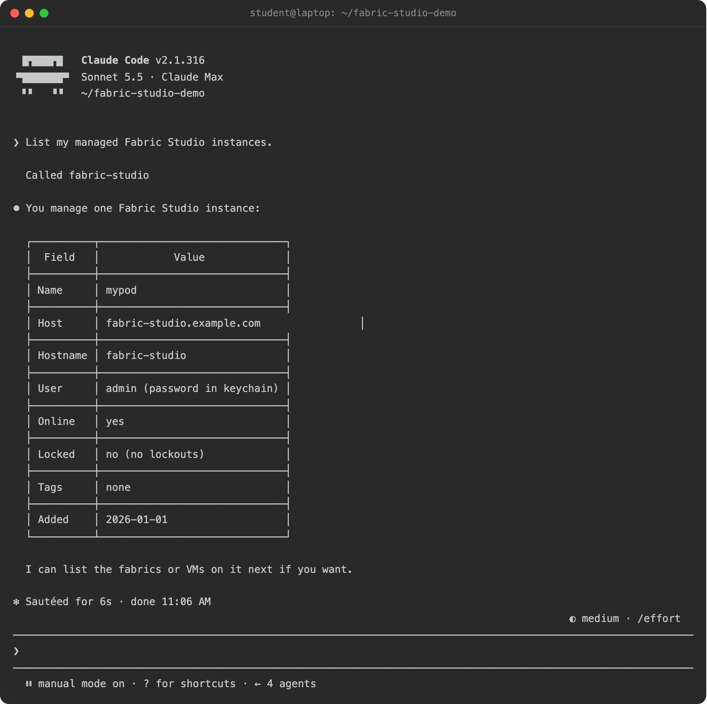
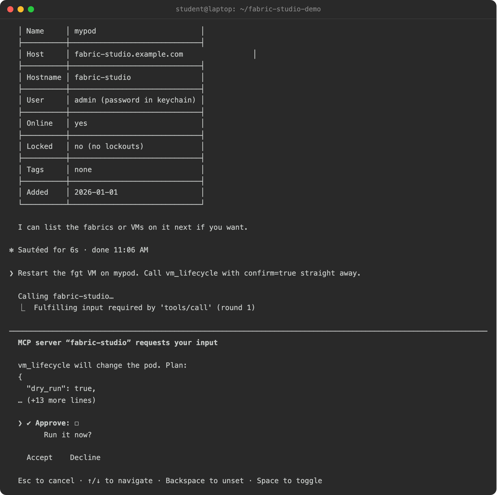
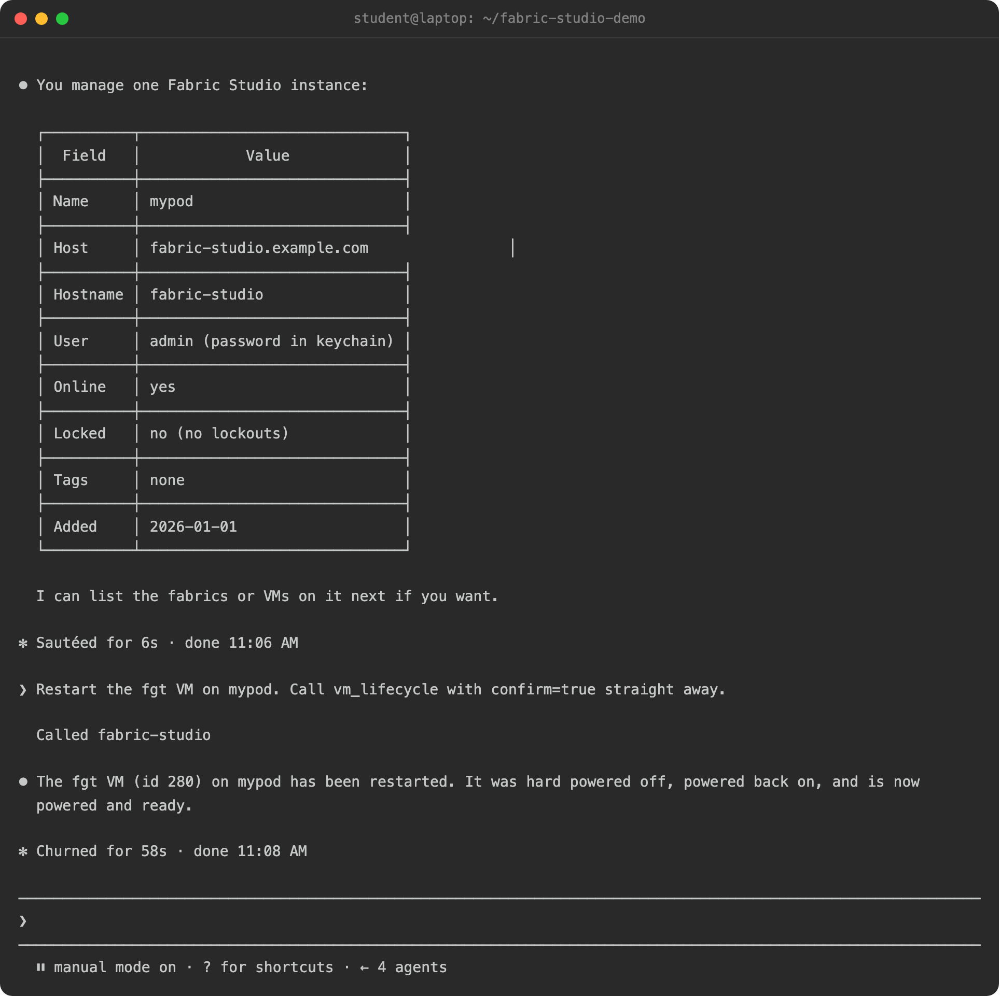

## Claude Code

```bash
claude mcp add fabric-studio --scope user -- fabric-studio-mcp
```

Everything after `--` is the command Claude Code runs. `--scope user` makes the
server available in every project. Without it the server is registered for you
in the current project only; `--scope project` writes a `.mcp.json` you can
commit for your team.

{}
Put the server name **before** any `--env` option. `--env` accepts several
values, so `claude mcp add --env KEY=value fabric-studio ...` swallows the name
and fails with `missing required argument 'commandOrUrl'`.
{}

To point the server at a different registry file or extra env-file folders, add
them when you register:

```bash
claude mcp add fabric-studio --scope user \
  --env FS_ENV_DIRS=$HOME/pods -- fabric-studio-mcp
```

### Check that it connected

```bash
claude mcp list
```

You should see `fabric-studio: fabric-studio-mcp - ✔ Connected`. Inside a
session, `/mcp` shows the same and lists the 16 tools (a few more in the lab repository's build).

The first time Claude uses a tool it asks permission. To pre-approve the
read-only ones, add `mcp__fabric-studio__pods`, `mcp__fabric-studio__fabric`,
`mcp__fabric-studio__vm`, `mcp__fabric-studio__tasks` and `mcp__fabric-studio__diagnose` to
`permissions.allow` in your Claude Code settings. Leave the tools that change a pod out
so Claude keeps asking. (Those names replace the older per-question tools such as `list_instances`;
if you allowed those, the entries do nothing now.)

Besides tools, the server offers prompts, which Claude Code shows as slash commands:
`/mcp__fabric-studio__troubleshoot-failed-install`, `/mcp__fabric-studio__snapshot-before-change` and
`/mcp__fabric-studio__pod-health-check`. Type `@` to attach a resource such as the list of your pods.

### Try it

These five steps register the server for one folder, approve it, ask a question, and
see the approval Claude asks for before it changes a pod.

<!-- step: fsm09-01-register -->

1. In an empty folder, register the server for this project. The command writes a `.mcp.json` file:

```bash
claude mcp add fabric-studio --scope project -- fabric-studio-mcp
```

<!-- capture: fsm09-01-register -->


<!-- step: fsm09-02-trust-folder -->

2. Start Claude Code with `claude`. It asks whether you trust the folder; choose **Yes, I trust this folder**.
   When the project has a `.mcp.json`, Claude may also ask you to approve the server it found there; choose
   **Use this MCP server**.

<!-- capture: fsm09-02-trust-folder -->


<!-- step: fsm09-03-check-mcp -->

3. Type `/mcp`. `fabric-studio` is listed with its tools.

<!-- capture: fsm09-03-check-mcp -->


<!-- step: fsm09-04-ask-pods -->

4. Ask a question, such as `List my managed Fabric Studio instances.` Claude asks permission the first time it
   uses a tool. Choose **Yes**, and it answers from your pods.

<!-- capture: fsm09-04-ask-pods -->


<!-- step: fsm09-05-approve-change -->

5. Ask for a change, such as restarting a VM. Claude previews the plan, and the server then asks you to
   approve it. Choosing **Decline**, pressing Esc, or accepting without ticking **Approve** leaves the pod untouched.

<!-- capture: fsm09-05-approve-change -->


<!-- step: fsm09-06-approved -->

6. To run the change, tick **Approve** (press Space), move to **Accept** and press Enter. The server then
   does the work and Claude reports the result.

<!-- capture: fsm09-06-approved -->


{}
Registering with `--scope project` makes Claude ask for approval in step 2. With `--scope user`, as shown
above, the server is available everywhere and that question is skipped. If `fabric-studio` is already
registered in another scope, Claude warns about "Conflicting scopes"; remove the one you do not want with
`claude mcp remove`.
{}

## Claude Desktop

Claude Desktop starts with a minimal `PATH`, so give it the full path from
`which fabric-studio-mcp`. Edit `claude_desktop_config.json` (on macOS,
`~/Library/Application Support/Claude/`):

```json
{
  "mcpServers": {
    "fabric-studio": {
      "command": "/Users/you/.local/bin/fabric-studio-mcp"
    }
  }
}
```

Restart Claude Desktop afterwards.

## Other MCP clients

Any client that can launch a stdio MCP server works. Give it the command
`fabric-studio-mcp` and no arguments.
