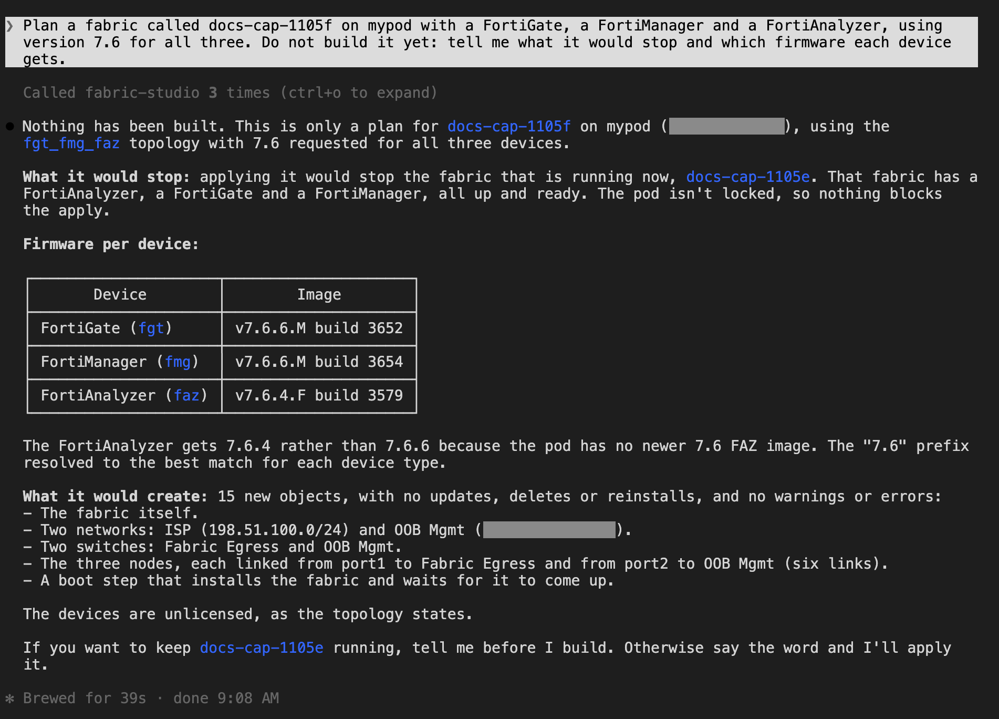
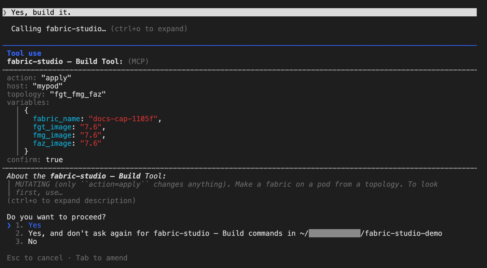
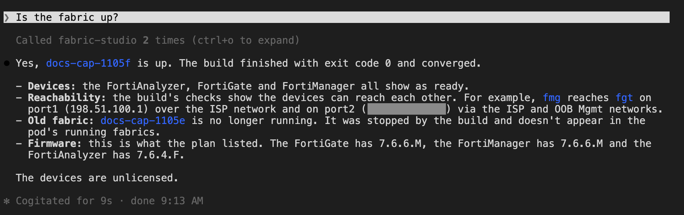
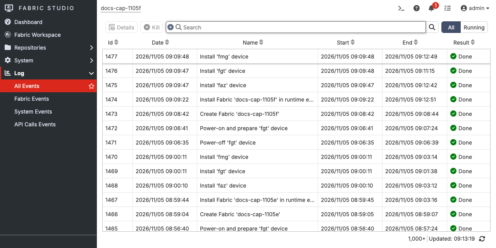
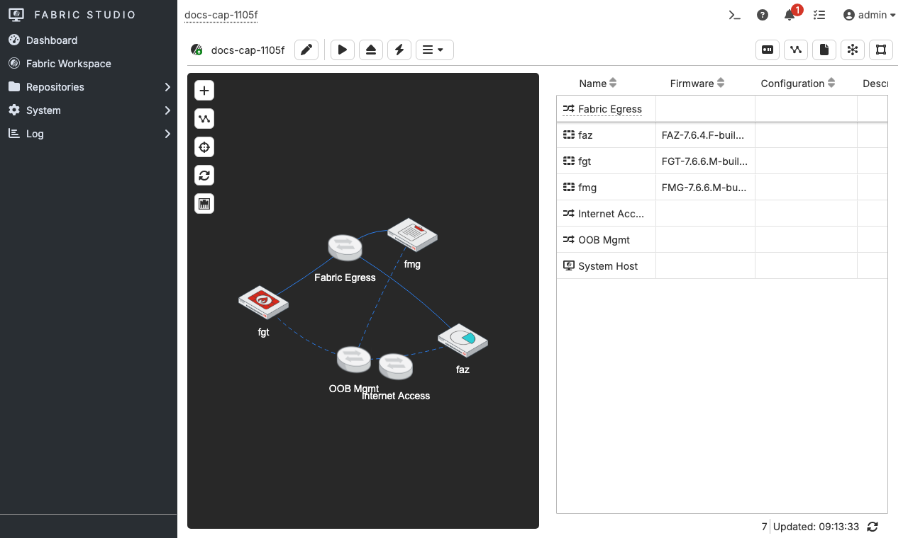
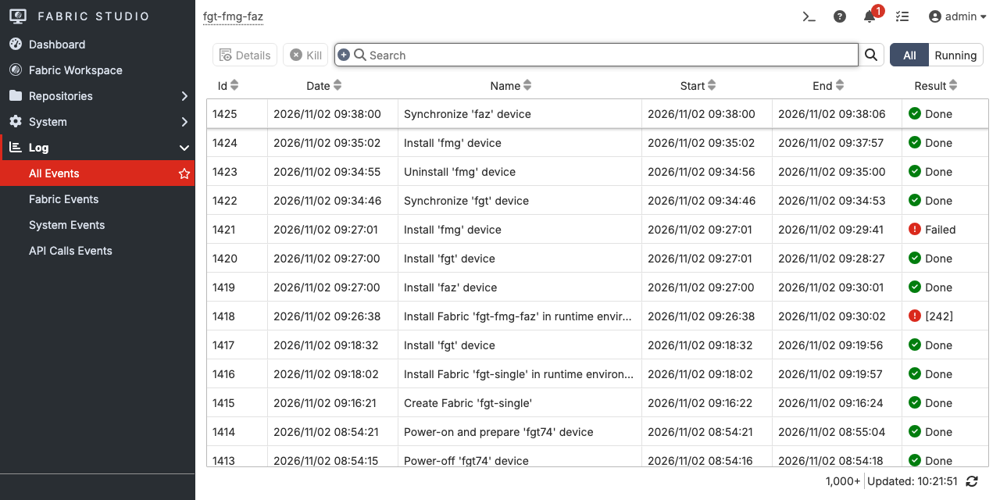

The **build** tool makes a whole fabric (devices, networks, switches and cables) from a **topology**, a small
file that says what you want. You describe what you need, Claude picks a topology, shows you what it would
do, and builds it once you approve. Nothing else is needed on your machine: the topologies ship with the
server, and there is no repository to check out.

You need the MCP server [registered with Claude]({}) and a
[pod registered]({}).

## How a build goes

**build** is one tool with five actions. Claude uses them in this order, and you see each result.

| Action | What it does | Changes the pod? |
|---|---|---|
| *topologies* | Lists what can be built: name, devices, and the variables each takes | No |
| *validate* | Checks one topology with no pod | No |
| *plan* | Shows what building it on your pod would create, reinstall or delete, which firmware each device gets, and which running fabric it would stop | No |
| *apply* | Builds it. You are asked to approve the plan first, then the build runs in the background and returns a run id | **Yes** |
| *status* | Follows a build by run id | No |

**A pod runs one fabric at a time.** Building a new fabric stops the one that is running. Its model stays,
so you can bring it back, but its devices go down. The plan names the fabric it would stop, and Claude tells
you before it asks for approval.

## What can be built

Ask: *"What fabrics can you build?"* Claude calls **build** with *topologies*. Two ship with the server:

| Topology | Devices | Network |
|---|---|---|
| *fgt_single* | one FortiGate | management network 10.254.254.0/24 |
| *fgt_fmg_faz* | a FortiGate, a FortiManager and a FortiAnalyzer | the same management network |

```text
fgt (10.254.254.30) ──┐
fmg (10.254.254.40) ──┼── OOB Mgmt 10.254.254.0/24 ── the Fabric Studio host (port-forwards)
faz (10.254.254.50) ──┘
```

Every device installs **unlicensed** (evaluation): the CLI and GUI work, and no FortiFlex points or pooled
licenses are used. An unlicensed FortiGate does not accept API keys, so to configure one with
[the device tool]({}) give it a license first. Topologies from a workspace folder are listed too: see
[Make your own](#make-your-own).

## 1. Ask for it

<!-- step: fsm09-07-build-plan -->

Ask for what you want in plain words. You do not have to name a topology.

```text
Build me a fabric on pod-a with a FortiGate, a FortiManager and a FortiAnalyzer.
```

Claude lists the topologies, picks *fgt_fmg_faz*, validates it and plans it. It then tells you what it
found and what it needs from you. Read three things in its answer:

- **What it will stop.** The running fabric is named. If that fabric matters, say no here.
- **What it will create or reinstall.** A reinstall rebuilds a device from its firmware, so anything you
  changed inside it is lost.
- **Which firmware each device gets.** See [Firmware](#firmware).

<!-- capture: fsm09-07-build-plan -->


## 2. Approve

<!-- step: fsm09-08-build-approve -->

When you say to go ahead, Claude calls **build** with *apply* and *confirm=true*. The server then runs the plan
again and asks **you** to approve it. The agent cannot answer for you. Tick **Approve** (press Space), move to
**Accept** and press Enter. Decline, Esc, or accepting without ticking **Approve** leaves the pod untouched.

<!-- capture: fsm09-08-build-approve -->


## 3. Watch it build

<!-- step: fsm09-09-build-done -->

The build starts in the background and **build** returns a run id at once, because an install takes minutes.
Claude follows it with *status*, and with **tasks** for the installs in flight. A build is finished when
*status* says it **converged**; a run that exits is not the same thing, so Claude checks both.

You can keep talking while it runs. Ask *"What is installing on pod-a?"* (**tasks**) or *"Is it up yet?"*

<!-- capture: fsm09-09-build-done -->


## 4. Check it came up

Ask: *"Is the fgt-fmg-faz fabric up, and can I reach each device?"* Claude calls **fabric** and **vm** and reports
each device's power, boot state and license mode (*NONE*, as an unlicensed install should show), and the
forwards that answer.

To log in, ask *"How do I log in to fmg?"*. **vm** (include *credentials*) gives the user, where the password
comes from, and the exact `fabric ssh` command. It never returns the password.

### See it in Fabric Studio

<!-- step: fsm09-10-fs-events -->

Everything Claude does goes through the same API the web UI uses, so Fabric Studio keeps its own record of it.
Open **Log > All Events** and every step is there, with its result:

<!-- capture: fsm09-10-fs-events -->


<!-- step: fsm09-11-fs-topology -->

And the fabric itself, under **Fabric Workspace**, with its topology:

<!-- capture: fsm09-11-fs-topology -->


## When a build fails

A build can fail for reasons a plan cannot see, such as an image that installs but will not boot. This
happened in testing. The first build of this fabric on one pod failed: FortiManager 8.0.0.F, the newest
image there, exited with return code 254 while the FortiGate and FortiAnalyzer installed fine.

What Claude did is what you should expect:

1. **Read the failure, not just the return code.** It called **diagnose** for the pod and fabric. A bare 254
   says little, so **diagnose** reads the failed task's log and named the cause: the build's login to the
   FortiManager was rejected.
2. **Decided that repeating it would not help.** The same image would fail the same way.
3. **Chose a different image and planned again.** *plan* showed one change: reinstall fmg on the other
   image. The FortiGate and FortiAnalyzer stayed as they were.
4. **Asked you again.** The retry is a new approval, with the new plan in front of you.
5. **Finished.** The build converged, and only fmg was reinstalled.

Fabric Studio's own record shows the whole sequence: the failed install, the uninstall, and the new install.

<!-- capture: fsm09-09-build-done-recovery -->


A build is safe to repeat. It only does what is still missing, and it never reinstalls a device that matches
its topology.

## Firmware

Left alone, each device uses the **newest usable image** on the pod: the newest in the home repository, and
only when the home repository has none, the newest in another repository (the pod downloads it on the
first install, which is slower). A 0-byte stub is never picked.

The plan names the image each device will use, and it **checks every firmware before anything is created**.
Ask for a version the pod does not have and the plan is blocked, and lists the versions it does have:

```text
node 'fgt': image '9.9' not found in home repository or the pod's other repos for FGT (have: ..., 7.6.6M)
```

To choose a version, name it in your request (*"use FortiOS 7.4"*). Claude passes it as a variable, for
example *fgt_image* set to 7.4: a version prefix picks the newest match.

## Prune and the ISP Router

Fabric Studio seeds an ISP Router into every new fabric. Left in place it blocks every later plan of that
fabric as a black hole, even one that reports no changes. If a plan is blocked for that reason, Claude asks
for *prune=true*, which removes the router. **Prune also deletes anything else the topology does not declare
in that fabric**, so the plan lists every delete. Read that list before you approve.

## Make your own

A topology is an *intent.yaml* in a folder named for it. To add yours, put it where the server looks:

```text
<workspace>/topologies/<name>/intent.yaml
```

Set `FS_WORKSPACE` to the workspace folder in the server's environment. **build** then lists it next to the
bundled ones, and the same validate, plan, approve flow applies. Start from a bundled topology: copy it, rename
the *fabric:* and the nodes, and change what you need. Keep each node's address unique within its network, and
give FortiManager and FortiAnalyzer at least 4 vCPU and 8192 MiB of memory, since less does not boot healthy.

## What this does not do

A build brings the devices up and gives you SSH and API access to each. It stops there. It does not register
the FortiGates with the FortiManager or FortiAnalyzer or create ADOMs. To configure a FortiGate once it is up, see
[Configure a FortiGate]({}). A topology that declares *images:* (firmware to upload or build) is refused
with a message that says so, instead of skipping the build. The lab repository's build of the server does the
device configuration phase for the topologies that declare it.

The server never lifts a lockout. If the pod is locked, *apply* refuses by design: ask whoever set it. See
[Troubleshooting a Failed Install]({}) for reading a failure
yourself.
