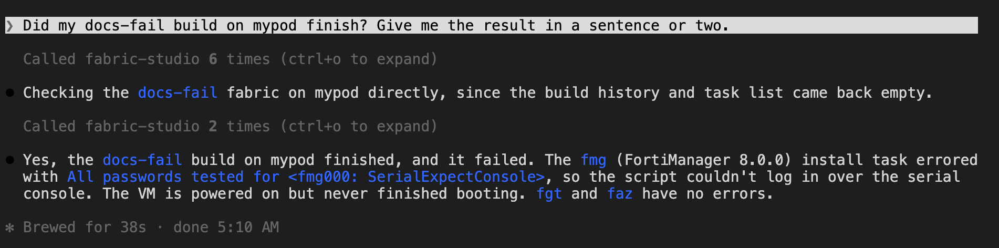
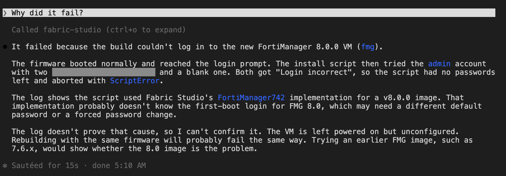

A failed install shows up as a task with a non-zero return code, almost always **254**. The code says
nothing. The reason is in the task's log, and the MCP server reads it for you. The same short routine
finds most causes.

## The routine

<!-- step: fsm09-16-build-failed -->

Start by asking how the build went. Here the pod has a fabric called `docs-fail` whose last build, of three
devices, failed on the FortiManager. Ask Claude: *"Did my docs-fail build on mypod finish? Give me the result in a
sentence or two."* It reads the build's result and tells you it did not finish cleanly:

<!-- capture: fsm09-16-build-failed -->


<!-- step: fsm09-17-diagnose -->

Then ask: *"Why did it fail?"* Claude diagnoses that same build. It starts with **diagnose**, one call that
checks every device, reads the failed task's log and ranks what it finds.

<!-- capture: fsm09-17-diagnose -->


 The steps below are what it
does underneath, and you can ask for any of them on its own.

1. **Is anything still running, or is the pod locked?** **pods** (view *health*), **tasks**
2. **Which task failed?** **tasks** with the device name returns its recent tasks and their return codes.
3. **Why?** **tasks** (with a task id) for that task id. The last lines name the reason.
4. **Is it the image?** **pods** (view *firmwares*) for the device type.
5. **Is it the license?** **pods** (view *licenses*), then **vm** (include *license*) for the device.

Steps 4 and 5 only matter when the log points at them. Read the log first.

## Read the log

This is a real failed install, as **tasks** (with a task id) returned it. The host name is removed.

```text
Install Fabric 'fortisoc-student-pod'
Uninstall previous Fabric
Cleanup runtime DB
  ...
Cleanup complete
VM license management: request license
Fatal: <Exception> License manager failed with: No license for faz000 (FLEX,LIC), fsm000 (LIC)
```

The lines before *Fatal:* are the install working normally, so the failure is at the license step,
and the message names the devices: faz000 and fsm000 had no license source. The return code for
that task was 254, the same as for every other failure.

## What the usual reasons look like

| The log says | Cause | What to do |
|---|---|---|
| *No license for &lt;node&gt;000 (FLEX,LIC)* | The device asked for a license (`license: auto`) and no source could supply one: no FortiFlex configuration for that device type, and no matching license in the pod's pool | Check **pods** (view *licenses*). Either pin a source in the topology (`license: {mode: auto, flex_config: ...}`), import a license file, or install unlicensed with `license: "none"` |
| `0-byte stub -- install would fail with rc 254` (from **build** with *plan*), or on a UI install *Internal error, reach remote file code for local file* | The image is a **0-byte stub**: a row marked downloaded whose file is empty | **pods** (view *firmwares*) shows *usable: false* for it. Pick another row for the same version (there is usually a working copy in the fortinet repository). **build** refuses the stub at plan time, before it changes anything; the UI does not |
| A device installs but never becomes ready | The task passed (return code 0) but the guest did not finish booting | **vm** (include *state*) for the device; for FortiSOAR, **vm** (include *guest_config*) |
| *Vm has no parameters* | A device row in the pod's model is missing its parameters | Inspect it with **vm** (include *detail*). We have seen this once, on a switch device, and have no verified fix |

The license row is the real log above. The stub row is also real: planning a build with a stub image
stops with `node 'fgt': image '850' (id=850) is a 0-byte stub -- install would fail with
rc 254` and changes nothing. The *Internal error, reach remote file code for local file* text is what
an install of a stub produced when it was started some other way.

{}
A task that ends with return code **0** can still leave a device broken, for example one that
installed unlicensed. A clean task is not proof of a healthy device. Check **vm** (include *state*) and the license
tools too.
{}

## Before you fix and retry

- **Know what a retry does.** Running the build again (**build** with *apply*) converges the fabric and only
  reinstalls devices whose settings changed. A reinstall rebuilds a device from firmware, so anything you changed
  inside it is lost.
- **Check the lock.** If **pods** (view *online*) shows the pod locked, *apply* will refuse by design. That is a
  deliberate freeze, not a failure. Ask whoever set it (**pods** (view *lockouts*) shows who).
- **Check the pod before blaming the topology.** **pods** (view *health*) shows disk and running tasks; a pod out
  of disk fails installs in ways that look like image problems.

## Ask it to explain

If the log is long or unfamiliar, ask: *"Read the log of task 1309 on pod-a and tell
me what to change in the topology."* Claude reads it with **tasks** (with a task id) and can open the topology file
to propose the edit.
