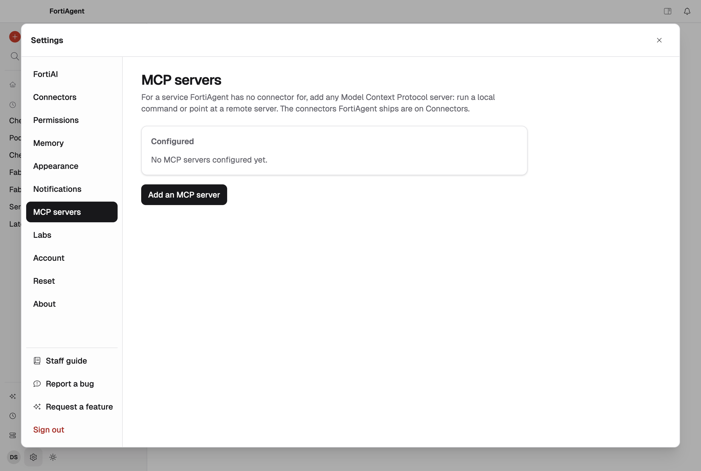
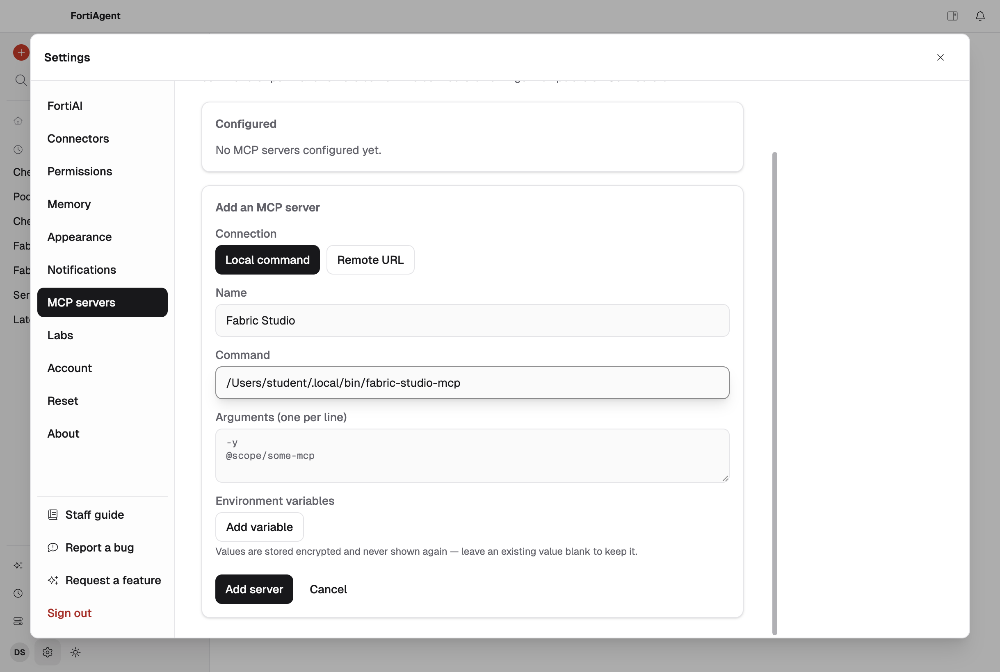
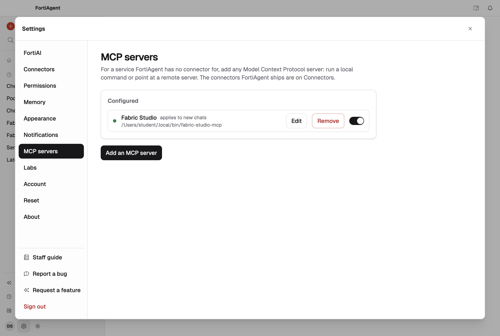
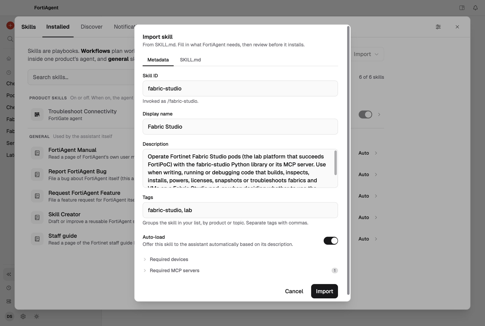
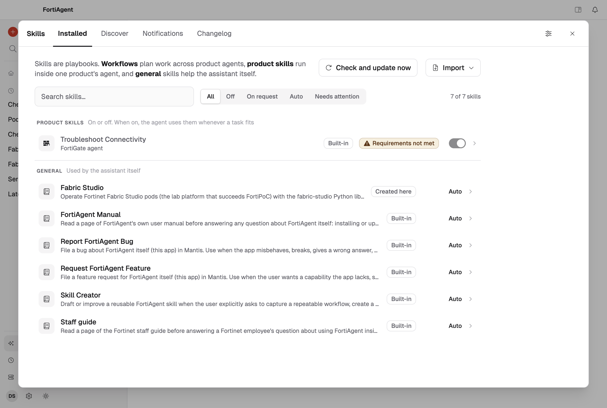
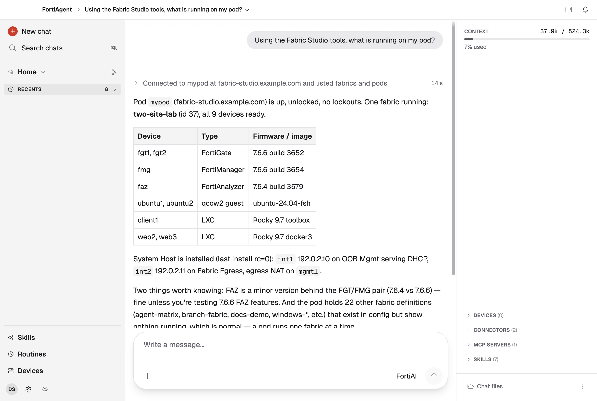

FortiAgent runs any Model Context Protocol server as a local command. Adding
`fabric-studio-mcp` gives its assistant the same tools Claude gets: what is
running on your pods, building fabrics, configuring FortiGates and running
commands on devices.

## Before you start

1. [Install the command]({}) from the download zip.
2. Add your Fabric Studio pod, in a terminal. This is the only place you type
   the pod's password: it goes into the macOS Keychain, and FortiAgent never
   sees it.

   ```bash
   fabric-studio-mcp setup     # asks for the hostname, a name, the user and the password
   fabric-studio-mcp pods      # your pod is listed
   ```

   More options are on [Connect a Pod]({}).
3. Find the full path of the command. FortiAgent does not search your shell's
   `PATH`, so it needs the whole path:

   ```bash
   which fabric-studio-mcp
   ```

## 1. Open the MCP servers settings

Open **Settings** (the gear at the bottom left) and choose **MCP servers**.
FortiAgent's own Fortinet connectors are under **Connectors**; servers you add
yourself go here. Click **Add an MCP server**.

<!-- step: fsm09-20-fortiagent-mcp-settings -->

<!-- capture: fsm09-20-fortiagent-mcp-settings -->


## 2. Fill in the server

| Field | Value |
|---|---|
| **Connection** | **Local command** |
| **Name** | `Fabric Studio`, exactly. FortiAgent makes the server's ID from it (`fabric-studio`), and the skill in step 4 looks for that ID |
| **Command** | the full path from `which fabric-studio-mcp`. Installed with `uv tool install` (from the download zip or a clone of the repository) it is `/Users/<you>/.local/bin/fabric-studio-mcp` |
| **Arguments** | leave empty |
| **Environment variables** | none |

<!-- step: fsm09-21-fortiagent-add-server -->

<!-- capture: fsm09-21-fortiagent-add-server -->


Click **Add server**.

{}
Leave **Arguments** empty: run with no arguments, `fabric-studio-mcp` is the MCP
server. The placeholder text (`-y`, `@scope/some-mcp`) is only an example for
npx servers.
{}

{}
No pod passwords go in this form. The server signs in to pods with the logins
you saved when you [connected a pod]({}).
{}

## 3. Check that it is listed

The server now shows under **Configured**, with its name and command. FortiAgent
starts it when a chat first needs it.

<!-- step: fsm09-22-fortiagent-server-ready -->

<!-- capture: fsm09-22-fortiagent-server-ready -->


If a chat later says the server failed to start, the **Command** path is usually
wrong: click **Edit**, run `which fabric-studio-mcp` again and paste the whole
path.

{}
Add the server once. A second server with the same name gets the ID
`fabric-studio-2`, which the skill does not recognise. To start again, **Remove**
the old one first, then add it.
{}

## 4. Add the Fabric Studio skill

The skill teaches the assistant how to use the tools well: which tool answers
what, how to plan before building, and the traps to avoid. It ships in the
download zip, at `fabric-studio/skills/fabric-studio/SKILL.md`.

Close Settings and open **Skills** (left bar). Click **Import** and choose
**Import from SKILL.md**, then pick that file.

<!-- step: fsm09-25-fortiagent-import-skill -->

<!-- capture: fsm09-25-fortiagent-import-skill -->


FortiAgent fills in the form from the file. Leave **Auto-load** on, so the
assistant uses the skill whenever a task is about Fabric Studio, and click
**Import**. FortiAgent shows the change as **Applied** on its **Changelog**
tab; open **Installed** to see **Fabric Studio** listed with the other skills.

If the skill shows **Requirements not met**, FortiAgent cannot find a server
with the ID `fabric-studio`: check the server's name in step 2.

<!-- step: fsm09-26-fortiagent-skill-listed -->

<!-- capture: fsm09-26-fortiagent-skill-listed -->


## 5. Ask about your pod

Close Skills, start a **New chat** and ask. A chat that was already open does not
see a server you just added until you click **Reload to apply changes** in its
sidebar; a new chat sees it straight away.

```text
Using the Fabric Studio tools, what is running on my pod?
```

FortiAgent's permissions start at **Auto** for a new MCP server, so it decides
for itself whether to ask before a tool runs. The Fabric Studio tools that only
read (what is running, a fabric's devices, a VM's state) are marked read-only,
and FortiAgent usually runs them without asking. If it does ask **Allow
FortiAgent to run this action?**, choose **Always · this server's reads** and
click **Submit**. Anything that changes the pod, such as building a fabric,
still comes back to you as a plan first.

FortiAgent calls the Fabric Studio tools and answers from the pod itself. It is
done when the **Stop** button turns back into **Send**.

<!-- step: fsm09-24-fortiagent-answer -->

<!-- capture: fsm09-24-fortiagent-answer -->


See [Things to Ask]({}) for more.
