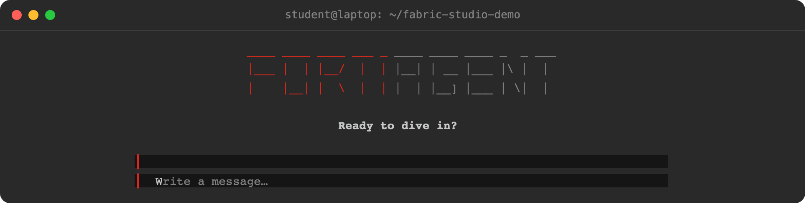
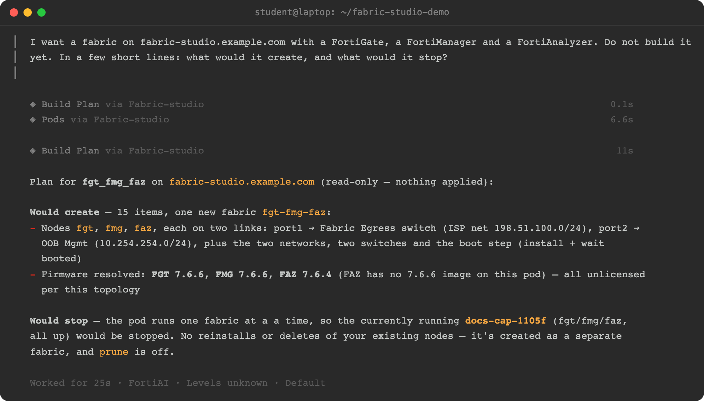
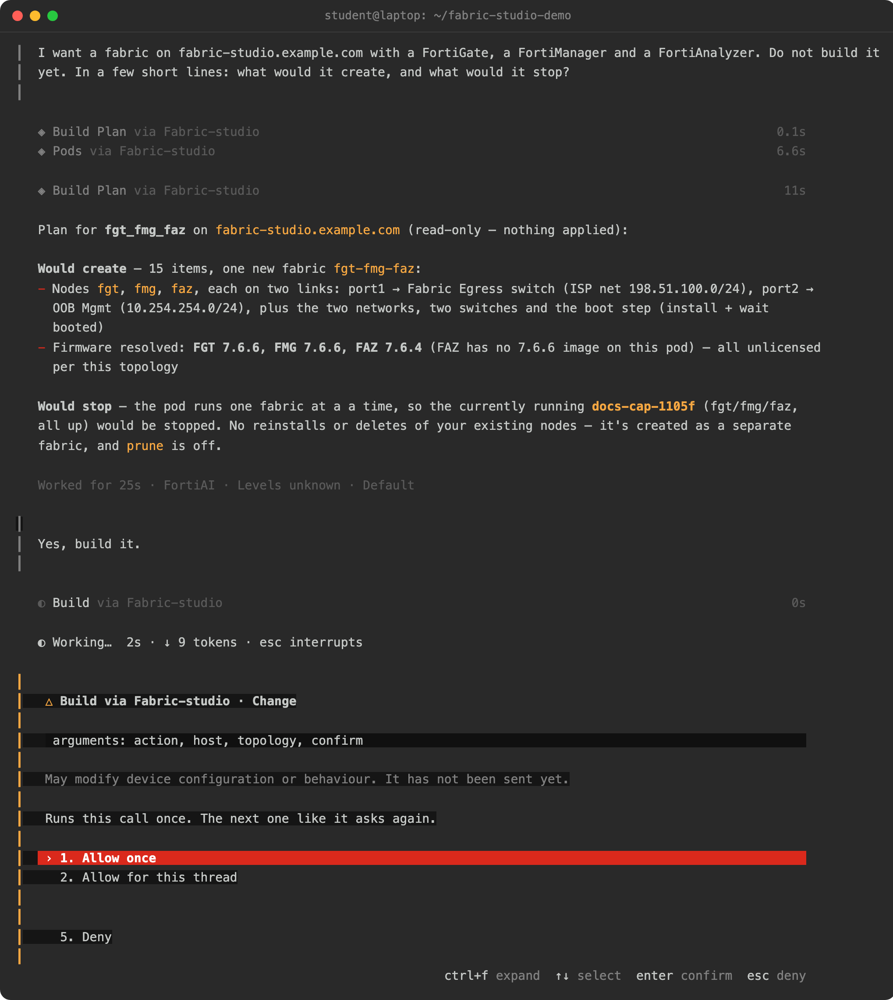
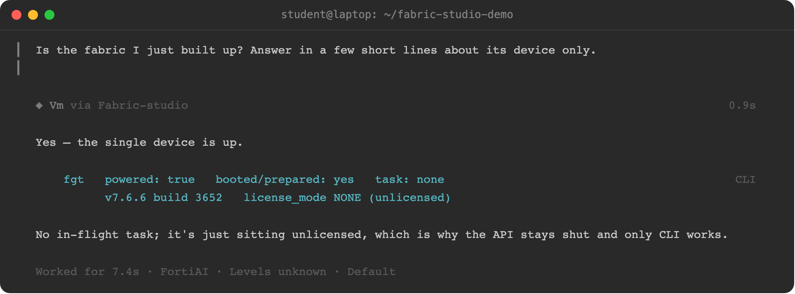

FortiAgent runs any Model Context Protocol server as a local command. Adding
`fabric-studio-mcp` gives its assistant the same tools Claude gets: what is
running on your pods, building fabrics, configuring FortiGates and running
commands on devices.

## Before you start

The screenshots were taken on macOS. FortiAgent runs on macOS, Linux and Windows and its settings are the same on
each, so only the window frame differs; commands and paths that differ by system are in tabs, and the choice is
remembered for the rest of the page.

1. [Install the command]({}) from the download zip.
2. Add your Fabric Studio pod, in a terminal. This is the only place you type
   the pod's password: it goes into your system's keychain (the macOS Keychain, Windows Credential Manager, or the
   Linux Secret Service), and FortiAgent never sees it.

   ```bash
   fabric-studio-mcp setup     # asks for the hostname, a name, the user and the password
   fabric-studio-mcp pods      # your pod is listed
   ```

   More options are on [Connect a Pod]({}).
3. Find the full path of the command. FortiAgent does not search your shell's
   `PATH`, so it needs the whole path:


{}
Open a terminal (macOS uses the same commands):

```bash
which fabric-studio-mcp     # for example /home/you/.local/bin/fabric-studio-mcp, or /Users/you/... on macOS
```
{}
{}
In PowerShell:

```powershell
where.exe fabric-studio-mcp     # for example C:\Users\you\.local\bin\fabric-studio-mcp.exe
```

{}
The Windows steps on this page follow FortiAgent's and the server's documentation but have not been verified on a
Windows machine yet.
{}
{}


{}
**Quick way:** run `fabric-studio-mcp connect fortiagent`. It runs FortiAgent's own `fortiagent mcp add` with the
right command path, then you can skip to [step 3](#3-check-that-it-is-listed). The steps below do the same by hand in
the app, which is also how you see what each field means.
{}

## 1. Open the MCP servers settings

Open **Settings** (the gear at the bottom left) and choose **MCP servers**.
FortiAgent's own Fortinet connectors are under **Connectors**; servers you add
yourself go here. Click **Add an MCP server**.

<!-- step: fsm09-20-fortiagent-mcp-settings -->

<!-- capture: fsm09-20-fortiagent-mcp-settings -->


## 2. Fill in the server

| Field | Value |
|---|---|
| **Connection** | **Local command** |
| **Name** | `Fabric Studio`, exactly. FortiAgent makes the server's ID from it (`fabric-studio`), and the skill in step 4 looks for that ID |
| **Command** | the full path from step 3: `/Users/<you>/.local/bin/fabric-studio-mcp` on macOS, `/home/<you>/.local/bin/fabric-studio-mcp` on Linux, `C:\Users\<you>\.local\bin\fabric-studio-mcp.exe` on Windows |
| **Arguments** | leave empty |
| **Environment variables** | none |

<!-- step: fsm09-21-fortiagent-add-server -->

<!-- capture: fsm09-21-fortiagent-add-server -->


Click **Add server**.

{}
Leave **Arguments** empty: run with no arguments, `fabric-studio-mcp` is the MCP
server. The placeholder text (`-y`, `@scope/some-mcp`) is only an example for
npx servers.
{}

{}
No pod passwords go in this form. The server signs in to pods with the logins
you saved when you [connected a pod]({}).
{}

## 3. Check that it is listed

The server now shows under **Configured**, with its name and command. FortiAgent
starts it when a chat first needs it.

<!-- step: fsm09-22-fortiagent-server-ready -->

<!-- capture: fsm09-22-fortiagent-server-ready -->


If a chat later says the server failed to start, the **Command** path is usually
wrong: click **Edit**, run `which fabric-studio-mcp` again and paste the whole
path.

{}
Add the server once. A second server with the same name gets the ID
`fabric-studio-2`, which the skill does not recognise. To start again, **Remove**
the old one first, then add it.
{}

## 4. Add the Fabric Studio skill

The skill teaches the assistant how to use the tools well: which tool answers
what, how to plan before building, and the traps to avoid. It ships in the
download zip, at `fabric-studio/skills/fabric-studio/SKILL.md` (with backslashes on Windows).

Close Settings and open **Skills** (left bar). Click **Import** and choose
**Import from SKILL.md**, then pick that file.

<!-- step: fsm09-25-fortiagent-import-skill -->

<!-- capture: fsm09-25-fortiagent-import-skill -->


FortiAgent fills in the form from the file. Leave **Auto-load** on, so the
assistant uses the skill whenever a task is about Fabric Studio, and click
**Import**. FortiAgent shows the change as **Applied** on its **Changelog**
tab; open **Installed** to see **Fabric Studio** listed with the other skills.

If the skill shows **Requirements not met**, FortiAgent cannot find a server
with the ID `fabric-studio`: check the server's name in step 2.

<!-- step: fsm09-26-fortiagent-skill-listed -->

<!-- capture: fsm09-26-fortiagent-skill-listed -->


## 5. Ask about your pod

Close Skills, start a **New chat** and ask. A chat that was already open does not
see a server you just added until you click **Reload to apply changes** in its
sidebar; a new chat sees it straight away.

```text
Using the Fabric Studio tools, what is running on my pod?
```

FortiAgent's permissions start at **Auto** for a new MCP server, so it decides
for itself whether to ask before a tool runs. The Fabric Studio tools that only
read (what is running, a fabric's devices, a VM's state) are marked read-only,
and FortiAgent usually runs them without asking. If it does ask **Allow
FortiAgent to run this action?**, choose **Always · this server's reads** and
click **Submit**. Anything that changes the pod, such as building a fabric,
still comes back to you as a plan first.

FortiAgent calls the Fabric Studio tools and answers from the pod itself. It is
done when the **Stop** button turns back into **Send**.

<!-- step: fsm09-24-fortiagent-answer -->

<!-- capture: fsm09-24-fortiagent-answer -->


## 6. Approve a change

Reading is safe to leave on Auto. A change to a pod, such as building a fabric, asks you first unless you set it to Auto. The terminal chat
shows the approval in full, so this section uses it: in a terminal, start the chat from a folder you do not mind
FortiAgent touching (it can read and write files where it starts).


{}
```bash
mkdir -p ~/fabric-studio-demo && cd ~/fabric-studio-demo
fortiagent chat
```
{}
{}
```powershell
New-Item -ItemType Directory -Force "$HOME\fabric-studio-demo" | Out-Null
Set-Location "$HOME\fabric-studio-demo"
fortiagent chat
```

The installer puts `fortiagent.cmd` on your `PATH`. If PowerShell does not find it, open the desktop app once (it
repairs the command on every launch) and open a new PowerShell window.
{}


<!-- step: fsm09-30-fortiagent-tui-open -->

<!-- capture: fsm09-30-fortiagent-tui-open -->


{}
`fortiagent chat -m "..."` answers one message and exits, so it cannot ask you anything. A task that changes a pod
needs this interactive chat or the desktop app.
{}

### Ask for a plan first

Name one of the bundled topologies (`fgt_single` is one FortiGate). Ask for the plan and say not to build yet.

```text
I want a fabric on mypod with a FortiGate, a FortiManager and a FortiAnalyzer. Do not build it yet. In a few short lines: what would it create, and what would it stop?
```

The plan is read-only. It lists what would be created, and **what it would stop**: a pod runs one fabric at a time,
so applying a fabric powers off the one running there (its settings stay, its guests' contents do not). The
fabric is named by the topology (`fgt-single`), not by your question.

<!-- step: fsm09-31-fortiagent-tui-plan -->

<!-- capture: fsm09-31-fortiagent-tui-plan -->


{}
FortiAgent's reviewer can block a call it thinks goes further than you asked ("Blocked by FortiAI review"), even for
a plan. The assistant is told why and usually finds another way. A red line in the answer from a tool that found
nothing to read (for example, no running fabric) is not a failure of the plan.
{}

### Approve the build

Say `Yes, build it.` FortiAgent shows its own approval sheet for the tool that changes the pod: **1. Allow once**,
**2. Deny**. Enter confirms the highlighted choice and Esc denies. This is FortiAgent's own prompt, not something
the Fabric Studio server adds.

<!-- step: fsm09-32-fortiagent-tui-approve -->

<!-- capture: fsm09-32-fortiagent-tui-approve -->


Read the plan in the sheet, in particular `would_stop` (the fabric that will be powered off, or `null`) and
`deletes`, before you choose.

{}
With the server's changes set to **Auto**, FortiAgent's reviewer can let a call through without showing the sheet
("Auto-approved by FortiAI review"). Auto is your setting to choose. To be asked every time, set the server's
changes to **Ask** under Settings, then Permissions.
{}

### Check the result

The build runs in the background and takes a few minutes: the chat returns as soon as it starts. Ask again when
you want the state.

```text
Is the fabric I just built up?
```

<!-- step: fsm09-34-fortiagent-tui-built -->

<!-- capture: fsm09-34-fortiagent-tui-built -->


{}
Another chat's pending approval can show up in a new chat (the header counts what is "waiting on you"). Deny any
sheet that is not about what you asked for.
{}

See [Things to Ask]({}) for more.
